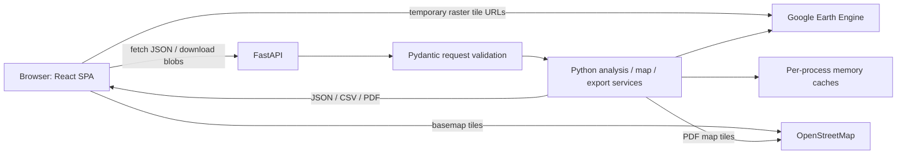

# 01 — Repository audit

Audit date: 2026-10-25 (Asia/Karachi). Source revision: `17d75b5d323f71839bab5703c4690d77cdc2e1cb`.

Status: analysis and documentation only. No existing application source, dependency manifests, configuration, or contracts were changed. Recommendations require approval before implementation.

## 1. Evidence and scope

**Verified** below means observed in repository source/configuration, not confirmed in a deployed service. **Proposed** means a future addition. **Unverified** means runtime access or behavior was not established during this audit. Source takes precedence over README claims.

The review covered the tracked frontend and backend tree: routes, components, services, validation and response schemas, dataset configuration, dependency manifests/lockfile, tests, styles/assets, deployment configuration, ignore rules, and existing documentation. Local directory inspection also identified ignored environments, dependencies, build/test artifacts, `.env` and example files, and a backend `secrets/` directory. Credential contents and populated `.env` values were not inspected or copied. Dependencies, generated build contents, and Git history are not first-party application source. No `AGENTS.md` was found in the repository or at `D:/AGENTS.md`.

The user calls the existing system **Mangrove One**. Repository branding is **Mangrove Carbon Explorer** / **Mangrove Carbon API**. There are no implemented MangroveTrust or MangroveSteward modules in this revision. Naming is not evidence of a separate existing system.

## 2. Actual architecture

There is no application database or application user authentication layer. Earth Engine authentication identifies the backend to Google; it does not identify people using the app. Existing SHA-256 hashes support logging/cache/version fingerprints, not blockchain anchoring or tamper-proof evidence storage.

### Frontend inventory

| Source | Verified responsibility |
| --- | --- |
| `frontend/src/main.jsx` | React `createRoot`, StrictMode, BrowserRouter, global stylesheet. |
| `frontend/src/App.jsx` | Exactly two client routes: `/` → Home, `/analysis` → Analysis. No protected routes or authenticated layout. |
| `frontend/src/pages/Home.jsx` | Landing page: Navbar, illustrative SVG preview, static Indus reference metrics, configured regions, methodology, datasets, CTA and footer. No API-backed project registry. |
| `frontend/src/pages/Analysis.jsx` | AOI/date form state, live analysis, fixed Indus reference summary, GMW overlap checks, map controls, result cards, warnings, stale-result handling and downloads. Primarily local React state/refs/effects. |
| `frontend/src/components/analysis/StudyAreaSetup.jsx` | Region/date/mode controls, geometry bounds/vertex summary and validation messages. |
| `frontend/src/components/analysis/StudyAreaMap.jsx` | React Leaflet map, OSM tiles, one drawn polygon with Leaflet Draw create/edit/delete, AOI boundary display, GMW overlay and analysis raster layers. |
| `frontend/src/components/analysis/mapLayers/{RasterTileLayers,LayerControls,LayerLegend}.jsx` | Raster display, visibility/opacity/reset controls and categorical/continuous legends. |
| `frontend/src/services/analysisRequestBuilder.js` | Prepared form preview → existing backend request (`study_area`, geometry, dates). |
| `frontend/src/services/analysisApi.js` | Native fetch clients, base URL validation, response-shape checks, ApiError, AbortSignal handling and export filename/content-type checks. No authorization headers/session management. |
| `frontend/src/config/studyAreas.js` | Indus/Abu Dhabi predefined geometries, dates, map center/zoom. |
| `frontend/src/utils/{geo,formatters}.js` | Polygon conversion, bounds/vertex calculations and display formatting. |
| `frontend/src/index.css`, `pages/{Home,Analysis}.css` | Design variables and page styling, responsive/reduced-motion rules. `App.css` contains template styling and is not imported by App. |
| `frontend/index.html`, `public/`, `src/assets/` | SPA entry, icon/illustration/template assets. Not an evidence repository. |

No Redux, query-cache library, persistent browser record store, service worker, mobile app, GeoJSON file upload, worker task screens, wallet connection, login/logout, or payment UI was found. "Saved custom vertices" in the UI means component state; it is not database persistence.

The Analysis page loads the fixed Indus carbon summary and global GMW overlay on mount. Both predefined and drawn-AOI submissions include geometry and therefore use the **live custom-AOI branch**. The fixed reference summary does not follow the selected region/date controls. Export controls compare request signatures and are disabled when results no longer match current inputs. Browser aborts prevent stale UI updates; they do not guarantee cancellation of backend EE work.

### Backend inventory

| Source | Verified responsibility |
| --- | --- |
| `backend/app/main.py` | FastAPI factory/app; routers; CORS; request IDs/timing/limited AOI metadata logging; response security headers; declared Content-Length size guard; liveness/readiness endpoints. |
| `backend/app/api/routes/{analysis,gee,map}.py` | All application API handlers; synchronous `def` handlers invoke services through the timeout wrapper. |
| `backend/app/core/config.py` | Frozen Settings dataclass, OS environment overriding `backend/.env`, defaults, production readiness configuration checks. |
| `backend/app/core/request_timeout.py` | Shared four-thread executor; waits for configured duration and raises HTTP 504. No durable job storage or running-operation cancellation. |
| `backend/app/core/gee_datasets.py` | Dataset/region catalogs, scientific constants, baseline/reference values and visualization settings. |
| `backend/app/services/analysis_service.py` | Demo/live dispatch, supported study-area catalog, warning-text-based error/no-data mapping; lazily creates its own stock-service instance. |
| `backend/app/services/gee_service.py` | EE initialization and status, service-account file/JSON or Google ADC credentials, sanitized connection failures. |
| `backend/app/services/gee_dataset_check_service.py` | Metadata/band/access checks, including Sentinel-2 metadata; fixed Indus AOI. |
| `backend/app/services/gee_rh98_summary_service.py` | Quality-filtered GEDI RH98 mosaic; fixed whole-AOI/mangrove-masked statistics and reference comparison. |
| `backend/app/services/gee_mask_service.py` | Positive-pixel GMW mask from Image or mosaiced ImageCollection. |
| `backend/app/services/gee_biomass_service.py` | Shared five-band biomass calculation helper and fixed Indus density summary. |
| `backend/app/services/gee_carbon_stock_service.py` | Fixed Indus stock summary, parameterized live AOI summary, processing/visualization fingerprints, map descriptors and caches. |
| `backend/app/services/gee_map_layer_service.py` | Regional/global GMW descriptor and polygon overlap/area check. HTTPS tile host validation. |
| `backend/app/services/export_service.py` | Shared ExportDocument, JSON/CSV/PDF rendering, numeric/filename/CSV safety. |
| `backend/app/services/export_map_service.py` | Server-side OSM + EE GMW tiles + AOI boundary map image for PDF. |
| `backend/api/index.py` | Vercel entrypoint re-exporting the same FastAPI app. |

There is no ORM, migration layer, repository/data-access layer, business transaction manager, evidence upload/object store, durable queue, blockchain client, contract project, RPC integration, signer, or payment adapter.

## 3. Complete current HTTP surface

These are implemented routes, not proposed Trust/Steward APIs. Source: `app/main.py` and the three route files.

| Method | Path | Inputs and actual behavior |
| --- | --- | --- |
| GET | `/` | Service metadata and health/docs links. |
| GET | `/health` | Always returns `{"status":"ok"}`. Liveness only. |
| GET | `/ready` | Configuration readiness JSON, without EE access. Returns HTTP 200 even for `ready=false`. |
| POST | `/api/analyze` | AnalyzeRequest. Without geometry: fixed demo values, only `indus_delta`. With geometry: live EE summary for `indus_delta`, `abu_dhabi`, or `custom`. |
| POST | `/api/analyze/map-layers` | AnalyzeRequest; geometry required; generates four live raster layer descriptors. |
| POST | `/api/analyze/export/{export_format}` | AnalyzeRequest; geometry required; `json`, `csv`, `pdf` constrained by path validation; uses cached analysis if present, otherwise computes it. |
| GET | `/api/gee/status` | Backend-to-EE connection/authentication status. |
| GET | `/api/gee/datasets/status` | Fixed Indus metadata-only access/band checks; no biomass reduction. |
| GET | `/api/gee/rh98/summary` | Fixed Indus Jan–Mar 2020 RH98 summaries/reference comparison. |
| GET | `/api/gee/biomass/summary` | Fixed Indus biomass/carbon **density** statistics. |
| GET | `/api/gee/carbon/stock-summary` | Fixed Indus mapped area, valid raster coverage, direct/extrapolated carbon stock. |
| GET | `/api/map/gmw-layer` | Query `study_area=indus_delta|abu_dhabi|custom`, default `custom`; temporary GMW tile descriptor. |
| POST | `/api/map/gmw-coverage-check` | GmwCoverageCheckRequest; mapped overlap/area for submitted polygon. |
| GET | `/docs`, `/redoc`, `/openapi.json` | FastAPI default documentation/schema routes. Also framework-generated `/docs/oauth2-redirect`; its existence does not mean OAuth login is implemented. |

Current APIs have no user identity or role dependencies. CORS is a browser-origin policy, not access control. There are no project registration, nursery, claim, verification, evidence-version, task, milestone, reward, payment, or ledger-history endpoints.

## 4. Existing models are API schemas, not stored entities

| File | Schema inventory |
| --- | --- |
| `models/analysis.py` | `AnalyzeRequest`; `StudyAreaInfo`, `DateRangeInfo`; `AnalysisResults`, `MethodologyInfo`; `AnalyzeResponse`, `CustomAoiAnalyzeResponse`; `MapLayerDescriptor`, `MapLayersResponse`; `ExportMetric`, `ExportScientificResults`, `ExportDateRangeInfo`, `ExportAoiBounds`, `ExportDocument`. |
| `models/map_layers.py` | `GmwLayerResponse`, `GmwCoverageCheckRequest`, `GmwCoverageCheckResponse`. |
| `models/gee.py` | `GeeStatusResponse`. |
| `models/gee_datasets.py` | `DatasetBandStatus`, `DatasetAccessStatus`, `DatasetMaskStatus`, `GeeDatasetsStatusResponse`. |
| `models/gee_rh98.py` | `Rh98Stats`, `Rh98ReferenceResults`, `Rh98ReferenceDifferences`, `GeeRh98SummaryResponse`. |
| `models/gee_biomass.py` | `BandStats`, `BiomassStatistics`, `GeeBiomassSummaryResponse`. |
| `models/gee_carbon_stock.py` | `CarbonDensityStats`, `AreaStats`, `StockStats`, `ReferenceComparison`, `GeeCarbonStockSummaryResponse`. |

`core/gee_datasets.py` adds configuration dataclasses `StudyAreaConfig` and `RegionConfig`; `gee_service.py` has credential/connection dataclasses. These are not user/project records. `study_area.id` is a catalog key, not an identifier for a registered restoration project.

AnalyzeRequest validates ordered dates, maximum span, Polygon-only geometry, ring closure/distinct points, numeric/finite coordinate ranges and geometry size/count limits. It does **not** implement complete polygon topology validation. The overlap-check model has considerably weaker geometry validation. The frontend normalizer keeps only the exterior ring; backend analysis supports interior rings. MultiPolygon is not accepted by AnalyzeRequest.

## 5. GIS data and scientific behavior

| Item | Verified source behavior |
| --- | --- |
| GEDI | `LARSE/GEDI/GEDI02_A_002_MONTHLY`; `rh98`, `quality_flag=1`, `degrade_flag=0`; quality-filtered mosaic. Raster cells are not unique GEDI shots. |
| GMW Indus | `projects/mangroves123/assets/GMW_2020_IndusDelta`, Image, positive `b1` mask. |
| GMW Abu Dhabi | `projects/mangroves123/assets/GMW_2020_AbuDhabi_v2`, Image. |
| GMW custom/global | `projects/sat-io/open-datasets/GMW/annual-extent/GMW_MNG_2020`, ImageCollection mosaiced before mask construction. |
| Sentinel-2 | `COPERNICUS/S2_SR_HARMONIZED` appears in metadata checks and demo labels; no Sentinel-2 restoration/survival or production biomass algorithm is implemented. |
| Reference geometry | Indus `[66.5,23.5,68.5,24.8]` temporary processing rectangle, not a legal/project boundary. Abu Dhabi `[54.32,24.40,54.52,24.55]` is labeled a verified study extent in source; external validity was not re-established. |
| Dates | Fixed scientific summaries: `2020-01-01` to `2020-04-01`; dataset check: `2019-04-01` to `2021-12-31`. Live AOI accepts requested dates. EE end date is exclusive. |
| Formula | AGB = 10 × RH98; BGB = 0.49 × AGB; TAB = AGB + BGB; Carbon = 0.5 × TAB. Constants in `gee_datasets.py`. Source warns this approximation is not locally calibrated. |
| Area/stock | GMW area reduction at 10 m, GEDI/biomass reduction at 25 m, `bestEffort=False`, tileScale 4 in stock pipeline. Uses pixelArea/10,000 for hectares; direct stock sums density × cell area; extrapolation uses mean density × full mapped area. |
| Overlays | GMW extent, valid GEDI raster coverage, carbon density, RH98 canopy height. Temporary tile URLs; not downloadable field evidence or permanent assets. |

The global overlay/overlap check and predefined-region analysis can use different GMW sources. The same polygon may therefore produce different results across modes. A 2020 GMW mask and sparse GEDI canopy estimates cannot establish that a fictional worker planted seedlings, completed a task, or achieved a later survival milestone.

### Persistence and export limitations

- Metadata/RH98/biomass/fixed-stock services retain a successful response in process memory. No durable history or regular refresh is implemented.
- Custom analysis cache keys hash sorted JSON of geometry, dates, processing fingerprint and GMW asset ID. They do not canonicalize equivalent polygon rings into a common geometric identity. Successful custom results have no TTL/size bound in this code.
- Analysis and map generation share a lazy stock-service instance; fixed-stock GET uses the module singleton, so their memory caches are separate.
- AOI map descriptors have generated/expiry times and TTL checks; descriptor storage is still process-local. Expired entries are not a durable archive.
- ExportDocument includes schema `module15_v1`, generation time, mode, processing fingerprint, AOI/bounds/vertices, dates/convention, datasets, units/results, methodology, assumptions/warnings and no-data flag. There is no persisted analysis ID, immutable evidence version or complete dataset revision manifest.
- A cache miss during export can recompute the analysis. An export is not guaranteed to be byte-identical to a previously displayed result. PDF map rendering also depends on fresh network tile requests.
- PDF rendering uses a temporary PNG file and cleans it up. The deployment guide's broad "in memory only" description is inaccurate for this step; no durable export storage exists.

## 6. Configuration inventory

Actual source defaults from `core/config.py`; populated local values intentionally omitted. OS variables override `.env`.

| Variable | Default / role |
| --- | --- |
| `APP_ENV` | `development`; changes production readiness and default GEE auth mode. |
| `API_VERSION` | `0.4.1`; FastAPI metadata version. |
| `HOST`, `PORT` | `127.0.0.1`, `8001`; settings exist, but external Uvicorn/container startup arguments determine binding. Docker defaults PORT to 8080. |
| `CORS_ORIGINS` | Development localhost:5173 variants; empty production default, explicit production allowlist required by readiness checks. |
| `REQUEST_TIMEOUT_SECONDS` | `120`; wait limit around routed service operations. |
| `MAP_LAYER_CACHE_TTL_SECONDS` | `1200`; AOI map descriptor expiry. |
| `LOG_LEVEL` | `info`; setting exists, but source does not configure Python/Uvicorn logging from it. |
| `MAX_REQUEST_BODY_BYTES` | `1000000`; middleware checks numeric declared Content-Length, not streamed cumulative bytes. |
| `MAX_AOI_TOTAL_VERTICES` | `5000`. |
| `MAX_AOI_INTERIOR_RINGS` | `20`. |
| `MAX_AOI_RING_VERTICES` | `2000`. |
| `MAX_AOI_SERIALIZED_BYTES` | `200000`. |
| `MAX_AOI_DATE_RANGE_DAYS` | `1461`. |
| `MAP_TILE_ALLOWED_HOSTS` | `earthengine.googleapis.com`; HTTPS required for EE descriptor URLs. |
| `GEE_ENABLED` | `false`. |
| `GEE_AUTH_MODE` | `service_account_key` in development, `adc` in production when not explicitly set; also supports `service_account_json`. |
| `GEE_PROJECT_ID` | Empty; required when GEE enabled. Dataset asset project IDs are separately hard-coded. |
| `GEE_SERVICE_ACCOUNT_EMAIL` | Empty; required for file/JSON service account modes. |
| `GEE_PRIVATE_KEY_FILE` | `secrets/gee-service-account.json`; backend-relative unless absolute; backend only. |
| `GEE_SERVICE_ACCOUNT_JSON` | Empty; sensitive full credential JSON; backend only. |
| `VITE_API_BASE_URL` | No source fallback; frontend fails clearly if missing. Example file points to local port 8001. Public build-time value. |

No existing database URL, identity-provider settings, object-store configuration, RPC/chain ID/contract address, signer key, payment-provider settings or durable queue configuration was found. ADC may use runtime Google environment outside this application; that is not an app login system.

Local `.env.example` files exist but are **not tracked** in this revision: root `.gitignore` excludes `.env.*` without an example exception. A fresh clone cannot rely on the README's copy commands succeeding.

## 7. Dependencies and deployment

Frontend manifest runtime dependencies: React/React DOM `^19.2.7`, React Router DOM **7.18.2**, Leaflet `^1.9.4`, Leaflet Draw `^1.0.4`, React Leaflet `^5.0.0`. Dev dependencies: Vite `^8.1.1`, React plugin `^6.0.3`, Vitest `^4.1.10`, jsdom `^29.1.1`, Oxlint `^1.71.0`, Testing Library React `^16.3.2`, user-event `^14.6.1`, jest-dom `^7.0.0`, React/DOM type packages `^19.2.17` / `^19.2.3`. A package-lock v3 is tracked; ranges are not installed-version guarantees. For example, locked Vite is **8.1.5**, requiring Node `^20.19.0 || >=22.12.0`; README's Node 18 minimum is stale.

Backend direct pins: FastAPI **0.115.14**, Uvicorn[standard] **0.35.0**, httpx **0.28.1**, pytest **8.4.1**, pytest-asyncio **0.26.0**, earthengine-api **1.7.37**, fpdf2 **2.8.3**, python-dotenv **1.1.1**, google-auth **2.40.3**. Pydantic and Pillow are used directly but supplied transitively rather than explicitly pinned. There is no complete Python transitive lockfile or separate production/test requirements file.

Deployment artifacts, not proof of deployment:

- Backend Dockerfile: Python 3.12 slim, non-root app user, `app.main:app`, PORT support, no reload. Docker ignore excludes secrets/env/tests.
- Backend Vercel config: all paths route to `api/index.py`; declared `maxDuration=300`. Provider entitlement/runtime limits were not verified.
- Frontend Vercel config: rewrites only `/` and `/analysis` to index.html. Future nested routes need additional rewrites.
- No tracked CI workflow, Compose/local orchestration, infrastructure-as-code, migration scripts, contract build/deployment tooling, or backup/restore configuration was found.
- Deployment guide contains a React Router advisory acceptance statement. This audit did not revalidate vulnerability reachability or current advisory status; that paragraph is historical documentation, not a new security certification.

## 8. Verification performed and limits

Initial Git status was clean. Existing frontend suite: **7 files, 139 tests passed**, using `npm.cmd test`. Initial sandbox run failed before test collection because a temporary-file rename was denied; the permitted rerun outside the sandbox passed. jsdom emitted a navigation-not-implemented message without failing tests.

Backend execution was attempted with GEE disabled: `.venv/Scripts/python.exe -m pytest tests -q -p no:cacheprovider` failed because the venv references missing `C:/Program Files/Python313/python.exe`. Available Python 3.12 then reported `No module named pytest`. No dependency installation or venv repair was performed. Backend tests are therefore **present and reviewed, but not executed successfully in this audit**.

Backend test files cover health/demo API, custom AOI validation/service behavior/maps, exports, EE authentication/metadata/RH98/biomass/stock, GMW diagnostics, production guards and Vercel timeout/routing. They use fake EE objects/monkeypatches; their presence and comments do not independently confirm live Earth Engine access. Frontend tests cover page/navigation, asynchronous analysis/error/no-data/stale handling, API clients/exports, geometry, request building, raster display and deployment configuration.

No live EE processing, credential validation, deployed-service test, blockchain transaction, payment, fresh dependency install, vulnerability scan, lint or production build was performed. Backend test execution and live asset permissions remain explicit uncertainties.

Next: [proposed system architecture](02-system-architecture.md), [gaps and reuse decisions](03-gap-analysis.md), [phases and approval decisions](04-implementation-phases.md).
