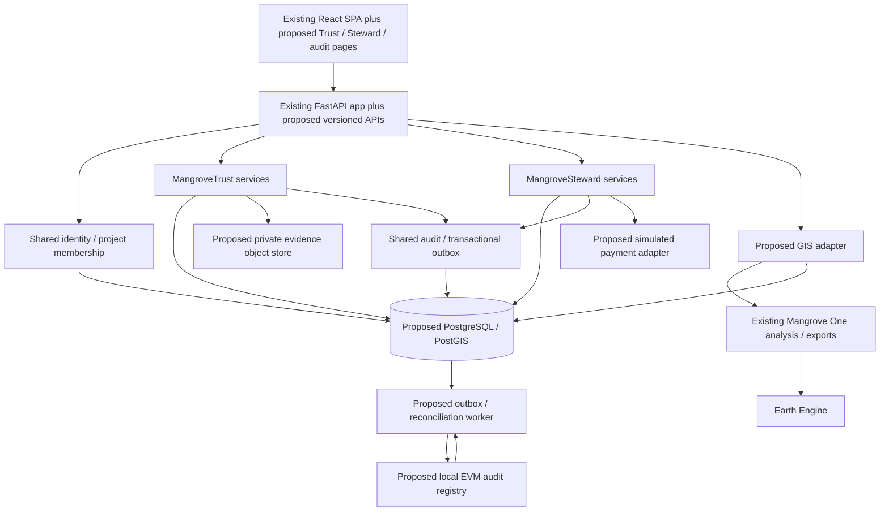
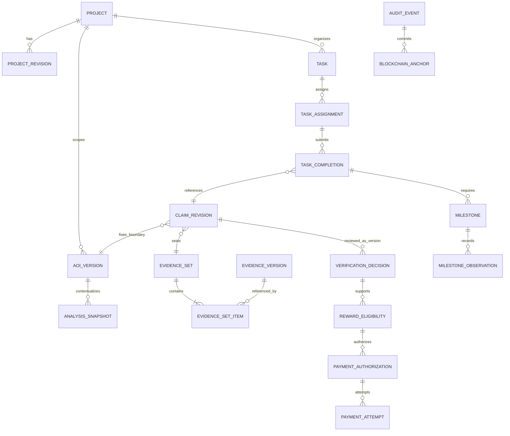

# 02 — Proposed system architecture

Status: **proposal for approval**, 2026-10-25. None of the Trust/Steward entities, endpoints, contracts or services described here exists in the audited revision unless explicitly marked **existing**. See [repository evidence](01-repository-audit.md).

## 1. Architectural decision

Extend the existing React SPA and FastAPI backend as a **modular monolith** with one shared PostgreSQL/PostGIS database. Keep Mangrove One's GIS calculations behind an adapter. Add private evidence storage and a small Solidity audit registry, developed on a local EVM first. Use a separate worker process from the same backend codebase for blockchain delivery and reconciliation. Avoid separate independently deployed Trust and Steward backends at university-demo scale.

This is a design recommendation: one transactional data model makes it practical to enforce the link between verified work and worker eligibility without duplicating projects, evidence or user identities. PostgreSQL offers primary/foreign keys, uniqueness and check constraints; cross-record business invariants additionally need transactions and application logic. [PostgreSQL constraints](https://www.postgresql.org/docs/current/ddl-constraints.html).

Use SQLAlchemy with Alembic for persistence/migrations, a PostgreSQL driver, a server-side session/authentication library, private S3-compatible storage, and a Python EVM client such as web3.py. Select and pin compatible versions during the approved foundation phase; these are **new dependencies**, not installed capabilities. Use one Solidity test/build toolchain (proposed Hardhat, version selected in phase 0). Do not introduce a token or tradable carbon credit.

## 2. Module responsibilities and boundaries

| Module | Owns | Consumes / restrictions |
| --- | --- | --- |
| Mangrove One adapter | AOI-context analysis requests, snapshots, analysis provenance and refresh status | Reuses existing EE computations and exports. Environmental context cannot approve a claim or authorize money. |
| MangroveTrust | Project registration revisions, nursery confirmation, restoration claim revisions, evidence sets, independent verification, audit anchoring | References shared AOI versions and identities. Verification approves an exact revision and evidence set. |
| MangroveSteward | Tasks/assignments, follow-up milestones, completion links, reward policies, eligibility, payment authorization and attempts | Reads approved Trust decisions through shared services. Does not create a second "verified" flag on copied claim data. |
| Shared platform | Users, project memberships, geometry versions, evidence assets/versions, audit events, outbox, idempotency, access checks | One stable identifier per object across modules. No module bypasses authorization or mutates another module's tables directly. |
| Blockchain adapter | Publishing/reconciling audit commitments and registry configuration | Records submitted/confirmed/finalized/reverted states separately from business approval. No photos, names or bank details on-chain. |
| Demo payment adapter | Fictional authorization execution/status/receipt | No real transfer, wallet balance, bank integration or real money settlement. |

Proposed code boundaries are `backend/app/modules/{identity,projects,evidence,trust,steward,audit}` with repositories/services/schemas and shared transaction utilities; `backend/app/integrations/{gis,chain,payments,object_store}`; `backend/migrations/`; root `contracts/`. Frontend additions can live in `src/pages/{trust,steward,audit}` and `src/services/` with shared UI components. These folders are proposals, not files created by this analysis.

Keep `/` and `/analysis`, and current `/api/analyze`, `/api/map/*`, `/api/gee/*` contracts stable initially. Add `/trust/*`, `/steward/*`, `/audit/*` frontend routes and `/api/v1/*` business APIs. Extend hosting rewrites for nested routes when those routes are implemented. Phase later extraction of GIS jobs only if actual latency warrants it.

## 3. Identity and permissions

Proposed initial identity: fictional seeded accounts, password hashes through a maintained password library, and opaque random server-side sessions. Store only a digest of session tokens, expiry and revocation metadata; use HttpOnly cookies, Secure in deployed environments, CSRF tokens/origin checks on writes, bounded session duration and login rate limits. This requires deliberate cookie/CORS deployment configuration: current `allow_credentials=False` cannot support credentialed cross-origin cookies. Prefer a same-origin API proxy in the integrated demo. Keep GEE credentials and any blockchain signer entirely backend-side.

A role selector may help the demo navigate between accounts but must actually establish a session as a seeded account. A browser-selected role or user ID is not authorization. A wallet is not required for community workers in the recommended first version.

| Role | Proposed permissions |
| --- | --- |
| Project coordinator | Draft/register assigned projects, assign nursery confirmer/verifier, create tasks and submit restoration claims. Cannot verify their own claims. |
| Nursery confirmer | Record stock/batch observations and confirmations for assigned projects; cannot approve their own nursery submission. |
| Community worker | View assigned tasks, submit completion/evidence, record follow-up observations and see their own eligibility/payment status. |
| Independent verifier | Review assigned project/nursery/claim/milestone revisions and append a reasoned decision. Must not be the submitter or assigned worker for that subject. |
| Payment authorizer | Approve an eligible frozen reward amount; cannot authorize their own reward or manufacture eligibility. |
| Auditor | Read permitted project timelines, commitments and redacted evidence metadata; no workflow writes. |
| System administrator | Manage fictional accounts, scoped memberships and system configuration; no hidden bypass of verification/payment rules. |

Memberships are project-scoped; system administration is separate. Authorize every read/write/download by identity, scope and ownership. Audit role grants and revocations. Distinct fictional people should perform submissions, verification and payment approval. They demonstrate separation of duties; they do not constitute organizational accreditation.

## 4. Shared relational data model

All rows use server-generated UUIDs, UTC timezone-aware timestamps and `is_demo=true`/dataset namespace for fictional records. Business dates such as planting and milestone due dates are explicit dates; recorded/captured timestamps are separate. Use optimistic `row_version` for mutable drafts, and append-only submitted revisions/decisions. Foreign keys should also enforce project consistency through composite keys or equivalent transactional checks.

The following is a **logical model**, not a migration or implemented API schema.

| Entity | Proposed key fields / relationships |
| --- | --- |
| `User` | id, fictional display name/login, password hash, active flag. Never reuse a real community member's identity. |
| `Session` | id, user_id, token_digest, expires_at, revoked_at; no raw session secret persisted. |
| `ProjectMembership` | id, project_id, user_id, role, active_from/to; unique active membership per role; separate system-role grants. |
| `Project` | id, demo code/name, owner/coordinator_id, current_revision_id, lifecycle state. |
| `ProjectRevision` | id, project_id, revision number, description, AOIVersion reference, synthetic agreement reference, evidence_set_id, submitted_by/at, supersedes_id. Immutable on submission. |
| `ProjectRegistration` | id, project_revision_id, decision/status, registrar_id, reason, decided_at; exact registration history, not a mutable checkbox. |
| `AOI` / `AOIVersion` | Stable AOI id scoped to project; immutable version id, Polygon geometry (SRID 4326), submitted GeoJSON bytes/object reference, normalized geometry hash/algorithm, bounds, computed area, source and creator. Unique `(aoi_id,version)`. |
| `AnalysisSnapshot` | id, project_id, aoi_version_id, request dates/convention, analysis state, source mode, result JSON, exact dataset/asset IDs, processing fingerprint, code revision, observed_at, captured_at, warning/assumption units and no-data status, canonical snapshot hash, optional export-version references. |
| `NurseryBatch` | id, project_id, batch code, species label, declared seedling quantity/unit, ready date, synthetic supplier/agreement reference. |
| `NurseryConfirmation` | id, batch_id, revision, declared/observed quantity, confirmer assignment, evidence_set_id, observation time, submitted_by/at. Decision references this immutable revision. |
| `RestorationClaim` / `ClaimRevision` | Claim id tied to project and optional task_id; revision id/number, activity type/date interval, AOI version, claimed quantity/unit, submitter, nursery allocations, evidence_set_id, optional analysis_snapshot_id, supersedes revision. |
| `NurseryAllocation` | claim_revision_id, nursery_confirmation_id, quantity/unit; supports multiple batches. Reserved/accepted/released allocation state and accounting to prevent over-allocation. |
| `EvidenceAsset` / `EvidenceVersion` | Stable asset id; immutable version, storage object key/version, raw-byte SHA-256, MIME, size, uploaded_by/at, capture timestamp/location with source/accuracy, description, supersedes_id. Filenames are metadata, not object paths. |
| `EvidenceSet` / `EvidenceSetItem` | id, project_id, manifest schema/digest and seal time; item links to exact EvidenceVersion ids/digests and labels. A submitted set is immutable. |
| `VerificationAssignment` | id, project_id, subject type + concrete subject FK, verifier_id, assigned_by/at, conflict checks, status. |
| `VerificationDecision` | id, assignment_id, exact subject revision FK, evidence_set_id/hash, outcome (`approved`, `rejected`, `changes_requested`), notes, verifier_id, decided_at, supersedes_decision_id/reversal reason if needed. |
| `Task` / `TaskAssignment` | task project/AOI version, type, required quantity/unit, evidence checklist, policy version, due date; assignment id, worker_id, assigned_by/at, accepted_at and completion state. |
| `TaskCompletion` | id, assignment_id, claim_revision_id, submitted_at; one canonical completion claim per submitted completion revision; explicitly shared with Trust. |
| `Milestone` / `MilestoneObservation` | Milestone belongs to completion/task with type, due date, criteria and required flag; observation id/revision, measured quantity/unit or counts, observation timestamp, worker, evidence set, exact verification decision. |
| `RewardPolicyVersion` | project-scoped policy id/version, activity/milestone conditions, fixed rate/quantity cap, unit, currency, rounding and required confirmations. Fictional, immutable once applied. |
| `RewardEligibility` | id, assignment/completion_id, claim_verification_id, policy_version_id, calculation snapshot, eligible amount_minor/currency, state, evaluated_at. Requirement-link rows reference the exact required milestone decisions. |
| `PaymentAuthorization` | id, eligibility_id, revision, frozen payee/amount_minor/currency, authorizer_id, approved_at, idempotency_key, authorization state. At most one active payable authorization per eligibility. |
| `PaymentAttempt` | id, authorization_id, attempt number, simulator reference, state, requested_at, completed_at, failure reason, receipt digest. Retries preserve one economic obligation. |
| `AuditEvent` | id, project_id, aggregate type/id/version, actor_id, action, previous/new state, subject/evidence hashes, occurred_at, schema and event digest; append-only. |
| `OutboxEvent` | event_id, audit_event_id, target, payload digest, delivery state, attempts, next_attempt_at, lease owner/expiry; created with business transition in one DB transaction. |
| `BlockchainAnchor` / `AnchorAttempt` | audit_event_id, event digest, chain_id, registry address/deployment id, tx hash, receipt block number/hash, confirmations/finality state, attempt/error metadata. |
| `IdempotencyRecord` | actor + operation + key + request digest, result/status, created_at; unique key scope, reject different payload under same key. |

Use concrete subject foreign keys and a constraint enforcing exactly one subject on VerificationAssignment/Decision (project revision, nursery confirmation, claim revision or milestone observation). A generic `subject_type, subject_id` alone loses referential integrity. Evidence attaches to an immutable set which the subject references, avoiding unconstrained many-purpose attachment IDs.

Do not store historical decisions against `current_revision_id` alone. An AOI edit, new evidence photo, changed quantity or corrected report creates a new submitted revision and requires a fresh decision. A historical approval continues to describe its original version only.

The diagram shows selected relationships; the table is the fuller logical model. Nursery and milestone decisions follow the same exact-version review mechanism.

### Data invariants

- Geometry: use WGS84 `[longitude,latitude]`, preserve all rings, reject invalid/zero-area polygons and excessive area/complexity. Use PostGIS validity and geographic/projected area checks; validity is a 2D OGC test, not a land-rights check. [PostGIS ST_IsValid](https://postgis.net/docs/ST_IsValid.html).
- Treat existing catalog values (`indus_delta`, etc.) as analysis configuration, separate from Project/AOI UUIDs. A project boundary is never inferred from the fixed Indus rectangle.
- Use integer minor units for money (fictional PKR amounts proposed), explicit currency, and Decimal arithmetic for quantities/rates. Round once using the policy's documented rule; never calculate payable amounts from formatted React values.
- A completion must reference a claim in the same project/AOI scope and the assigned worker. Nursery planting allocations cannot exceed independently confirmed available stock; enforce with locking/transactions, and release rejected/superseded reservations.
- Verification and authorization must enforce actor conflicts and current subject versions server-side. Admins cannot silently rewrite decisions.
- One payable reward per completion/policy milestone component, enforced with a unique business key. Payment retries cannot generate additional obligations. Same-payload retries return the existing result; changed payload with reused idempotency key is a conflict.
- No-data, unavailable, demonstration, live-context and approved-work states are distinct. Missing data cannot be coerced into a successful measurement or a zero reward justification.

## 5. Workflows and cross-module integration

### Registration → nursery → restoration verification

1. Coordinator creates a fictional project and draft ProjectRevision, chooses a new AOIVersion, and attaches synthetic agreement/evidence. Registration records an explicit reviewer decision on that revision.
2. Nursery participant submits a batch observation; a distinct confirmer reviews the exact confirmation revision/evidence set. The confirmed quantity becomes allocatable, without proving later planting.
3. Coordinator creates a worker task against the registered project/AOI version. A planting task requires confirmed nursery stock; maintenance tasks need not.
4. Assigned worker submits TaskCompletion, which references a Trust ClaimRevision including activity quantity, time, nursery allocations and sealed evidence. This is one claim seen in two module views, not two copies.
5. Assigned independent verifier reviews the frozen claim and adds an approved/rejected/changes-requested decision. Requested changes require a new revision and re-review. Every state transition writes an AuditEvent and, for anchorable events, OutboxEvent in the same transaction.

Proposed state paths:

- Project revision: `draft → submitted → registered | rejected | changes_requested`; registered project can later be suspended/closed through audited actions.
- Nursery confirmation: `draft → submitted → confirmed | rejected | changes_requested`.
- Claim revision: `draft → submitted → under_review → approved | rejected | changes_requested`. Corrections append revisions; explicit disputes/reversals append decisions.
- Task assignment: `assigned → accepted → in_progress → completion_submitted → verified_complete | changes_requested | rejected`; verified completion requires Trust approval, not a worker checkbox.

### Follow-up → eligibility → authorization → payment status

1. On verified completion, create the policy's follow-up milestones (example timing/criteria require approval). Workers submit immutable observations with measurement/evidence sets; independent verifiers review those observations.
2. Steward's eligibility service reads the exact claim decision and all required milestone decisions, active project state, allocation validity and immutable reward policy. It stores the formula inputs, units, approved quantity/rate and resulting amount.
3. Eligibility paths are `pending_requirements → eligible | ineligible`, with `held`/`revoked` for a later dispute/reversal. Completion approval alone does not authorize payment. Optional immediate and follow-up tranches must be separate policy components with unique obligation keys.
4. A separate authorizer approves an eligible obligation. Transactionally recheck the dependencies and freeze the amount; do not trust a browser-calculated amount. Authorization paths: `requested → authorized | rejected | cancelled`.
5. The demo payment adapter accepts an idempotent authorization and returns `queued → processing → simulated_paid | failed`. Every status explicitly says simulated. A retry after failure creates an attempt under the same authorization; unknown outcomes require reconciliation before retry.
6. A later verification reversal immediately holds unpaid eligibility and authorization. If already simulated-paid, append a dispute/correction record; do not erase the receipt or pretend to reverse an actual transfer.

Proposed policy: require finalized anchors for the claim/milestone decisions that establish eligibility before payment authorization. Other workflow operations can proceed while anchoring is pending. When the chain is unavailable, show approved-but-anchor-pending separately and hold authorization. This gate is an approval decision, not an existing feature.

### Service/API integration

Use in-process application services and a shared transaction for immediate cross-module invariants. Avoid internal HTTP calls between Trust and Steward in the same backend. Outbox delivery handles external effects; an in-memory event alone cannot guarantee reward creation or anchoring after restart.

| Proposed HTTP surface | Purpose |
| --- | --- |
| `POST /api/v1/auth/login`, `POST /api/v1/auth/logout`, `GET /api/v1/auth/me` | Seeded-user sessions. |
| `POST/GET /api/v1/projects`, `GET /api/v1/projects/{id}` | Shared project records and scoped lists. |
| `POST /api/v1/projects/{id}/revisions`, `POST /api/v1/project-revisions/{id}/submit`, `POST /api/v1/project-revisions/{id}/register` | Explicit registration workflow. |
| `POST /api/v1/projects/{id}/aoi-versions`, `POST /api/v1/aoi-versions/{id}/analysis-snapshots` | Versioned geometry and optional GIS context capture. |
| `POST /api/v1/evidence/uploads`, `POST /api/v1/evidence/uploads/{id}/complete`, `GET /api/v1/evidence-versions/{id}/download` | Authorized uploads, validation/finalization and bounded downloads. |
| `POST /api/v1/evidence-sets`, `POST /api/v1/evidence-sets/{id}/seal` | Explicit immutable submission manifest. |
| `POST /api/v1/projects/{id}/nursery-batches`, `POST /api/v1/nursery-batches/{id}/confirmations` | Stock declarations and independently reviewed confirmations. |
| `POST /api/v1/projects/{id}/claims`, `POST /api/v1/claims/{id}/revisions`, `POST /api/v1/claim-revisions/{id}/submit` | Restoration claims and amendments. |
| `POST /api/v1/verification-assignments`, `POST /api/v1/verification-assignments/{id}/decisions` | Scoped exact-version decisions across subject types. |
| `POST /api/v1/projects/{id}/tasks`, `POST /api/v1/tasks/{id}/assignments`, `POST /api/v1/assignments/{id}/completions` | Worker task flow, linked to claim revisions. |
| `POST /api/v1/completions/{id}/milestones`, `POST /api/v1/milestones/{id}/observations` | Follow-up requirements and observations. |
| `POST /api/v1/completions/{id}/eligibility-evaluations`, `GET /api/v1/eligibilities/{id}` | Server evaluation and explainable reward outcome. |
| `POST /api/v1/eligibilities/{id}/payment-authorizations`, `POST /api/v1/payment-authorizations/{id}/attempts`, `GET /api/v1/payment-authorizations/{id}` | Approval, simulated execution and status. |
| `GET /api/v1/projects/{id}/audit`, `GET /api/v1/anchors/{id}`, `POST /api/v1/evidence-versions/{id}/integrity-checks` | Scoped audit timeline, anchor status and integrity verification. |

Endpoint shapes are illustrative contracts for later OpenAPI design. Add pagination, deterministic sort, validation, 401/403 access errors, 409 version/idempotency/transition conflicts, 422 invalid inputs, and request IDs. Every mutation uses session/CSRF protection; sensitive transitions use idempotency and expected revision. Lists/downloads enforce the same scopes as writes.

## 6. GIS integration and evidence provenance

Reuse the existing `/analysis` experience unchanged first. A new project AOI editor can compose existing low-level map/layer/formatting code, with a business-specific parent and preserved geometry. Do not make current GMW-overlap UI behavior a registration precondition: degraded restoration sites may have no mapped 2020 mangrove pixels.

The proposed GIS adapter takes AOIVersion, explicit region/source selection and dates; calls existing Python services; saves the returned data as an AnalysisSnapshot with warnings, provenance and the actual source/asset identifiers. The current API response provides display dataset names rather than a complete revision manifest, so the adapter must supplement configuration/code/version metadata. Store failed/no-data statuses explicitly. No successful GIS result is required merely to register a project or submit field work.

Persist the exact analysis result/export bytes used in a submitted claim; do not rerun an existing export endpoint later to reconstruct historical evidence. Store hashes of exact files separately from a canonical structured-data digest. Snapshot capture time is not satellite acquisition time; preserve both where available. Source asset mutation can still limit reproducibility and must be disclosed.

## 7. Evidence storage and blockchain audit

Private object storage holds original bytes, immutable object versions and generated snapshots. PostgreSQL holds metadata and access rights. Use server-computed hashes, bounded uploads, type inspection, safe filenames, authorization on upload completion/download, quarantining until validation, short-lived download links and retention policy. A declared MIME type, EXIF GPS, or photo timestamp is an unverified assertion until reviewed.

An evidence set seals exact version IDs/raw-byte hashes and a canonical manifest. Proposed hashing protocol: versioned canonical JSON (for example RFC 8785), UTF-8, deterministic ordering, explicit units, amounts as integers and measurements as canonical decimal strings; domain-separated SHA-256 digests. Store canonical bytes as well as digests and publish cross-language vectors before contracts. Hashing a file differs from hashing its metadata or an IPFS CID; specify which digest is compared.

Proposed minimal non-upgradeable `MangroveAuditRegistry` contract:

- Restricted demo publisher role; emit a commitment event and retain `eventId → digest` to reject duplicates/conflicts.
- Record event ID, opaque project reference, event type/schema, exact revision/subject commitment, payload/evidence-manifest digest and optional previous-event digest. No evidence URLs or identifying worker/payment details.
- Anchor registration, nursery confirmation, claim submission/revision, verification decision/reversal, milestone decision, eligibility and payment authorization/status events. All ordinary drafts need not be on-chain.
- Corrections append a new event linked to the previous one. Never overwrite an old commitment.

**Trust boundary:** the recommended initial backend relayer publishes events after app-level actor checks. The chain proves a particular digest was included by the authorized publisher; it does not independently establish who inspected a site or that planting occurred. Compromised publisher/admin keys remain a risk. If the university requires independent wallet-signed attestations or contract-enforced reward rules, that is a different approved scope (see decision register).

Blockchain delivery: commit business state + audit/outbox transaction; worker leases outbox work; submits to configured chain/registry; records transaction; polls receipts/block hashes; marks mined then finalized under an explicit network policy. Handle timeouts, dropped/replaced transactions, RPC failure, duplicates and reorganizations. Query the registry by event ID before resubmitting an uncertain transaction. Serialize nonce management for the demo signer; retries cannot create conflicting commitments. Do not mark "anchored" solely because an RPC returned a transaction hash.

Develop on a local EVM with test accounts and no real funds. A public testnet demonstration is optional after local acceptance; Ethereum currently describes Sepolia as an application-development testnet. Recheck its lifecycle/provider access when implementing, then configure chain ID, registry and confirmation/finality policy explicitly. [Ethereum network documentation](https://ethereum.org/developers/docs/networks/).

An anchor digest is useful only while the corresponding evidence remains retrievable. Public commitments must use opaque identifiers and nonces in private manifests where guessable personal data would otherwise be exposed; a plain hash does not make low-entropy personal data private. Keep originals private and use audited redacted derivatives for presentation.

## 8. Demo and case-study boundaries

The Delta Blue Carbon public site supplies contextual inspiration for mangrove restoration/community activity in Sindh. It is **not** a source of this application's internal workflows, rates, worker identities, contracts or evidence. No affiliation, operational access or partnership is claimed. [Public Delta Blue Carbon overview](https://deltabluecarbon.com/).

All demo users, agreements, nursery batches, work claims, rates and receipts must be labeled fictional. Use a fictional project name and hand-authored/demo-safe boundaries, not a claim that the Indus processing rectangle is a Delta Blue Carbon concession. Existing satellite data may be real environmental context; seeded scientific fixtures must instead say simulated/fixture and never masquerade as live EE output.

The system demonstrates traceability and workflow controls. It does not certify a carbon removal, create a credit, prove land rights, or implement a real payroll/payment system. Those are outside the requested demo.

## 9. Proposed runtime configuration

Retain existing GIS variables; add only after approval: `DATABASE_URL`; session signing/CSRF and cookie-origin settings; private object-store endpoint/bucket/credentials and upload limits; `CHAIN_ID`, `CHAIN_RPC_URL`, registry address/deployment identity, signer secret reference, finality policy; worker polling/lease/retry controls; explicit demo seed namespace and `PAYMENT_MODE=simulated`. Exact names and secret providers are to be finalized in phase 0. Never place database, storage, session or signer secrets in `VITE_*` variables.

A container backend plus separate worker, static SPA behind a same-origin proxy, PostgreSQL/PostGIS and private object store is the proposed integrated runtime. Current Vercel/Cloud Run files remain evidence of deployment options, not a provisioned business platform. New persistence/workers require their own lifecycle, backups, migrations, health checks and deployment configuration.
