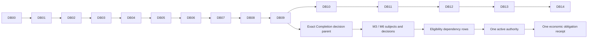

# 05 — Database refinements and migration dependency order

Every table/migration here is **PROPOSED**, not applied. Retain the full [PB-1 logical catalog/ERD](../playbook/04-database-model.md). The following deltas and constraint recipes resolve its implementation gaps without duplicating the catalog.

## Mandatory schema amendments

| Aggregate | Exact amendments / invariant |
| --- | --- |
| assignments | worker_id, collector_id, coordinator_id, task_revision_id, policy_version_id, site_version_id, quantity_atoms, unit_scale; unique active task_revision+worker; immutable pin set. New `assignment_reviewers` records stage, reviewer_id, roster_version, active interval/reason; one active stage reviewer. |
| projects / supply | project_revision default nursery_confirmer_user_id selected by O; `supply_declarations.confirmer_id` immutable snapshot. Declaration version tied to batch; confirmation references exact declaration/evidence. New revisions cannot double-count remaining stock from the same physical fictional batch. |
| supply inventory | maintain one locked batch inventory ledger; confirmation revision has effective confirmed balance and prior consumed/reserved quantities carried forward. Never reset available count by declaring same batch again. Allocation references exact effective confirmation, claim and assignment. |
| inspections / decisions | parent_completion_decision_id on each follow-up subject and decision; original_cohort_count fixed to that decision accepted quantity; due/grace dates and assessment source. New Completion parent invalidates prior follow-ups even if count unchanged. |
| inspection purpose | immutable enum observation/review_visit; review_visit references review_assignment and original subject/observation. Observation correction uses base_revision_id and same stable inspection. Submission of review_visit validates/seals report but does not create a recursive review task. |
| policy/component | profile enum plantation_final_v 1/configured_components; immutable task_type code, requires_supply, unit_scale, rate/cap/minimum bps, calendar offsets and grace. Structured agreement JSON/canonical bytes/digest required at publish; optional file FK added only after evidence exists. |
| quantity/currency | Decimal(18,4) display quantities; quantity_atoms=Decimal*unit_scale exact integer (no hidden round). Scale allowed 1/10/100/1000/10000. Primary seedling scale 1; pricing amount=floor(acceptedAtoms*rateMinor/unitScale), capped. Primary money exactly acceptedQ*1000 capped 1000000. |
| evidence | scope/purpose/concrete target; immutable raw version/canonical metadata after seal. Raw site JSON and agreement canonical bytes can initially live in DB so early sprints do not depend on future uploads. Object copy references supplement, not replace, digest. |
| authority/settlement | persist human_state independent chain state; one active approved/requested authority per obligation. Economic obligation UUID stable across reissued authorities and chain reset; simulator unique receipt uses that UUID, not deployment-scoped chain key. |
| deployment / commands | deployment generation random 32-byte identity recorded before deploy; UUID → chain key mapping per generation; command event ID and hash exact; signed raw tx encrypted/restricted, nonce/hash persisted before broadcast. Signer secret keys never stored in DB. |
| current pointers | current revision/check/decision/evaluation fields are projections; typed historical FKs remain authoritative. Deferrable FK/current-pointer writes completed within same transaction, not disabled constraints. |

## Concrete relational constraints

Every project-scoped table has UNIQUE(project_id, id) and composite FK to its related resource in same project; organization consistency established through project FK. No unconstrained generic target string for review, dispute, evidence target or eligibility dependency.

- ReviewAssignment CHECK exactly one claim_revision_id or inspection_revision_id; inspection subject has constant purpose=observation and composite FK(project_id, inspection_revision_id, purpose). ReviewDecision field report FK uses constant purpose=review_visit. This prevents accidentally reviewing a verifier's report as its own worker observation.
- Follow-up parent FK uses (project_id, parent_completion_decision_id, parent_stage) with parent_stage constant Completion. Partial unique effective decision per subject/roster; decision outcome and measurement are immutable, effectiveness/reversal is an audited projection.
- CHECK positive/nonnegative quantities and valid units/scales; integer primary counts; census live+dead+missing=originalQ; no nonfinite coordinates. Geography area computation/topology uses PostGIS. Membership active tuple and published version number unique.
- UNIQUE(assignment_id, policy_component_id) obligation regardless claim revisions. Partial unique authority for human_state requested/approved and not cancelled; chain pending does not free slot. Rejected/cancelled history never occupies slot.
- UNIQUE(economic_obligation_id) simulator_receipts; positive amount/currency frozen to authority; settlement_attempts unique authorization+attempt_no and stable simulator key. Receipt immutable; disputed flag derives from separate incident history.
- UNIQUE(event_id, consumer, step), UNIQUE(deployment, event_key), UNIQUE(deployment, tx_hash, log_index); intent UNIQUE(event_id, recipient, template, channel); scheduled job UNIQUE(milestone, kind, due_date, parent_completion_decision_id).
- Draft row_version optimistic concurrency; submitted content protected by DB trigger/restricted write path. Cross-row conflict/stock/threshold constraints need service transactions (and targeted triggers where appropriate), not invalid SQL CHECKs querying other rows.

PostgreSQL provides constraints and row locks; application aggregate checks still require a deliberate transaction design. [Constraints](https://www.postgresql.org/docs/current/ddl-constraints.html), [locking](https://www.postgresql.org/docs/current/explicit-locking.html).

## Migration dependency graph

Logical IDs below map one-to-one to proposed `backend/migrations/versions/DBxx_<slug>.py`. Alembic revision IDs may use a tool-generated identifier but must retain DBxx in doc string. No migration has run.

| ID / proposed slug | Prerequisites | Tables/alterations / sprint |
| --- | --- | --- |
| DB00_postgis | approved DB setup | PostGIS extension/version check, migration metadata; fail clearly if extension permission unavailable. Sprint 1. |
| DB01_identity_events | DB00 | organizations/users/org memberships/sessions; audit_events/outbox/operations/idempotency/intents/notifications/read-state base; nullable project UUID without FK until DB02. Sprint 1. |
| DB02_project_scopes | DB01 | project shells/project memberships/deployment registry/signer bindings; attach project scope FKs to foundation. No real deployment/account keys created by migration. Sprint 1. |
| DB03_sites_projects | DB02 | sites/site_versions/raw JSON/canonical bytes; project_revisions; attach nullable current revision/site/default C FKs after both parents exist. Sprint 2. |
| DB04_policy_types | DB03 | task_type_versions/policy_versions/components/requirements/structured agreement; attach project revision policy pointer. Optional agreement evidence FK deferred DB06. Sprint 2. |
| DB05_tasks_rosters | DB04 | tasks/task_revisions/assignments/assignment_reviewers; milestones templates with null dates/parent until planting accepted. Initial obligation identified by component configuration; actual obligation rows added DB12. Sprint 2. |
| DB06_private_evidence | DB05 | uploads/assets/versions/sets/items; scope/purpose/target refs; add optional policy agreement evidence FK, raw site object-copy refs. Sprint 3. |
| DB07_supply_claims | DB06 | batches/declarations/confirmations/batch inventory ledger/allocations; claims/revisions; attach evidence targets to new parents; claim current-check UUID initially nullable. Sprint 3. |
| DB08_screening | DB07 | check_runs/findings typed claim target; inspection UUID nullable until DB09; add claim → current CheckRun FK after CheckRun → claim FK exists. Sprint 4. |
| DB09_reviews_visits | DB08 | inspections/revisions with deferred review pointer; review_assignments/decisions; wire purpose FKs/current decision/cohort parent; disputes/revocations with typed target columns; add check inspection FK. Sprint 4. |
| DB10_chain_delivery | DB09 | commands/attempts/event projections/nonce leases; attach signer/deployment/operation refs; canonical generation and command dependencies. Sprint 5. |
| DB11_monitoring_jobs | DB10 | add/validate M3/M6 parent/due/grace/checkpoint fields/indexes and scheduled jobs; reuse inspection/decision tables from DB09. Sprint 6. |
| DB12_rewards_authority | DB11 | obligations/evaluations/dependencies/authorizations; evidence/decision/chain operation FKs; unique active authority constraints. Backfill obligations from existing assignments deterministically. Sprint 7. |
| DB13_simulation | DB12 | settlement_attempts/simulator_receipts/economic-key uniqueness; typed dispute-authority refs. Sprint 7. |
| DB14_acceptance_indexes | DB13 | scope/time/lease/inbox/audit/receipt indexes and validated constraints only; no late rewrite/duplicate tables. Sprint 8. |

Foundation tests may create a minimal draft project shell for membership scope before full ProjectRevision UX. Every revision/pointer cycle is resolved by creation order and explicit later FK, not fictitious dependencies. Reports do not require another mutable reporting database.

## Atomic operations and lock order

Lock order across domain mutations: project → task/assignment → inventory batches sorted UUID → subject/review → milestone → obligation → authority/receipt; services avoid acquiring earlier locks after later ones. Outbox lease acquisition is its own short transaction and external work happens after lease commit.

1. Claim submit locks assignment and relevant batch ledgers; verifies current effective confirmed balance minus consumed/reserved; reserves all or none; seals submitted revision/check operation/audit/intents. Correction atomically transfers only unconsumed reservation; consumed physical quantity not reset.
2. Decision locks exact target/review and affected dependent projections; checks actor/current inputs/field report/flags; consumes accepted quantity with explicit unaccepted remainder accounting; freezes Completion cohort and dates or survey result; creates next-role event and evaluator intent.
3. Authorization locks obligation and source decision set; recomputes current D01 formula/mask/nohold; creates one authority/idempotent outbox command. No RPC inside lock; sign later from frozen inputs.
4. Simulator first reads canonical chain authority/isExecutable outside DB transaction. Then locks obligation, checks generation/dependency digest and current DB holds again, and inserts local simulator receipt + attempt result + audit/outbox atomically. Dispute takes same lock: before receipt it blocks; after receipt it marks disputed history. Do not claim atomic finality across DB and blockchain; later reorg creates discrepancy/hold, no duplicate local receipt.
5. Local receipt exists but chain audit assertion failed: retain it, mark audit discrepancy and reconcile; never delete it to retry simulated payment.

## Migration/recovery controls

Additive schema first; no DROP/rewrite of accepted history. Each migration has empty-DB and prior-version-upgrade tests, schema diff review and isolated down/recreate test only when safe. Data-bearing correction favors forward migration plus backup/restore. Never automatically downgrade after published evidence/decisions exist.

Back up DB+private immutable objects+canonical manifests+deployment registry before destructive repair. A new EVM generation archives receipts/projections and rebuilds in dependency order; economic receipt keys stay unchanged. Seed/reset only isolated namespace with explicit target verification. All of this is future runbook behavior, not work performed during PB-2.
