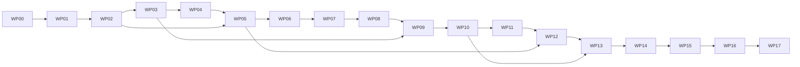

# 08 — Dependency-aware sprint work packages

**PROPOSED; every WP is NOT STARTED.** Sprints 0–8 require individual user authorization and stop after their reports. No date promises without team/deadline input. PB-1 related IDs below are its actual screen/API/test/backlog references.

## Dependency graph and sequencing adjustment

This is a conservative serial critical path; independent tests/design may overlap inside an authorized sprint, never bypass dependencies. Minimal audit/outbox/notifications introduced WP02, not deferred until Sprint 8. Observation/report tables begin WP08 to enable planting field visits; M3/M6 capability turns on WP11/12. Publication/assignment commits record chain awaiting_dependency before Sprint 5; no fake chain confirmations. Four small task-type demonstrations follow completed plantation logic, not separate engines.

## Shared work-package contract

Path expansion: backend shorthand `modules/`, `business/`, `workers/` and `integrations/` is relative to `backend/app/`; frontend shorthand `pages/`, `components/`, `services/` and `utils/` is relative to `frontend/src/`. DBxx migration names are relative to `backend/migrations/versions/`. An existing-file edit is never permission to replace the entire file or unrelated scientific behavior.

All paths below are proposed future create/change targets; braces expand to exact listed filenames, with module files from 02 where explicitly referenced. Each WP requires current permission/scope guards, documentary API/ABI/schema parity and no scientific algorithm edits. Integration tests use disposable actual DB/object store/local chain where relevant. UI test includes accessibility/error 409/role cases; E2E names PB-1 FLOW cases.

Every WP output includes changed-file list, exact command/result/exit-code evidence and manual observations; not screenshots alone. Recovery never erases accepted evidence/decisions/receipts; additive schema and forward fix preferred. No remote deployment/public chain/real transfer in any sprint.

## Sprint 0 — Reproducible baseline

### WP00 — Environment and evidence baseline

- **PB-1/preconditions:** B01–B03, LEGACY-01; user explicitly authorizes Sprint 0; review AGENTS/PB-2. No feature prerequisite.
- **Files:** update `README.md,PRODUCTION_DEPLOYMENT.md,.gitignore`; create sanitized `backend/.env.example,frontend/.env.example,.python-version,.nvmrc`; `docs/execution/12-progress-tracker.md` records exact installed versions/test outputs. Preserve old venv/credentials; isolated `backend/.venv-pb2` ignored.
- **Dependencies:** DB/API/K/frontend feature integration **none**; inspect current package engines/lock, select compatible stable Node/Python/toolchain targets; install existing baseline deps only within approved environment.
- **Tests:** existing backend pytest, frontend test/lint/build; do not compile/deploy contract or create DB migration. **Manual:** clean setup instructions, `/` and `/analysis` routing/config absence behavior, no live EE required. **Output/DoD:** reproducible baseline, actual pass/failure counts; all required baseline failures resolved or explicitly blocked without silently proceeding.
- **Risk/recovery:** broken venv/OS ACL/runtime availability; new env isolated, do not delete old; restore only own config/doc changes. Gate G0 then STOP.

## Sprint 1 — Persistent identity, scope and shared shell

### WP01 — Database, identity and project scope

- **PB-1/preconditions:** F01/F02, SEC-01–08, S01; G0 ACCEPTED and Sprint 1 authorized.
- **Files:** `backend/app/business/{database,unit_of_work,authorization,errors}.py`; `modules/identity/{router,schemas,models,repository,service,permissions}.py`; `backend/migrations/{env.py,versions/DB00_postgis.py,versions/DB01_identity_events.py,versions/DB02_project_scopes.py}`; `backend/alembic.ini`; direct dependency lock/requirements additions; register business router in existing main.py.
- **Dependencies:** DB00 → 01 → 02; A01–A03/A66/A67 baseline; K01/K04 schema only, no chain runtime yet; FE S01 session client.
- **Tests:** unit conflicts/session, DB migration and HTTP scope integration, SEC families; **manual:** login/logout/expiry/cross-project denial. **Output/DoD:** durable users/sessions/scopes, test DB restart, no admin approval bypass.
- **Risk/recovery:** schema extension permissions/FKs; back up isolated DB, forward fix; no destructive existing dataset changes.

### WP02 — Shell, audit/outbox and first inbox

Create the proposed browser acceptance harness in this package: `frontend/playwright.config.js`, `frontend/e2e/auth.spec.js` and `frontend/package.json` script `test:e2e`, with compatible pinned development dependency/lock changes. Later sprints extend this harness rather than waiting until Sprint 8 to test connected behavior.

- **PB-1/preconditions:** F03/F05, S02/S07/S09/S10; WP01.
- **Files:** `backend/app/business/{events,idempotency}.py`; `modules/notifications/{router,schemas,models,repository,service}.py`, `modules/audit/{router,schemas,models,repository,service}.py`; `workers/{main,outbox}.py`; frontend app files from 02, `pages/platform/{Login,Dashboard,Notifications,AccessAdmin,Operations}.jsx`, `services/{businessApi,sessionApi}.js`; additive App.jsx/main.py registration.
- **Dependencies:** DB01/02; A04/A57–A61/A73/A77/A78; no K execution; FE session and protected layout.
- **Tests:** UI-01/02/07/09/10, NOTIF/REC-01, transaction rollback; **manual:** event → one inbox entry, read not another user, restart leased worker. **Output/DoD:** shared navigation+durable audit/idempotency/job handling; E01/E02 unchanged.
- **Risk/recovery:** duplicate delivery/route rewrite; feature flag business shell only, keep published events; rollback own routing without touching science. Gate G1 then STOP.

## Sprint 2 — Project/site/rules/assignment vertical segment

### WP03 — Project, AOI and immutable agreement

- **PB-1/preconditions:** P01/P02, T01–T03, A05–A16; G1 ACCEPTED, Sprint 2 authorized.
- **Files:** `modules/{projects,sites,policies}/{router,schemas,models,repository,service,permissions}.py`; `business/canonicalization.py`; DB03_sites_projects.py/DB04_policy_types.py; frontend `pages/platform/{Projects,ProjectWorkspace,ProjectEditor}.jsx`, `pages/trust/{SiteEditor,RulesEditor}.jsx`, `utils/businessGeometry.js`.
- **Dependencies:** DB02 → 03 → 04; A05–A18/A82/A83; planned K02/03/05/06/no actual chain; frontend S03/S04/T01–T03.
- **Tests:** GEO/POLICY/DATA-01, UI-03/04/11–13; **manual:** degraded site and hole, structured agreement publish, no PDF dependency, primary constants read-only. **Output/DoD:** saved/published exact project/site/policy with honest awaiting_chain badge.
- **Risk/recovery:** geometry loss/early upload dependency; preserve raw JSON, additive versions; correction new revision, not overwrite.

### WP04 — Typed task definitions and worker assignment

- **PB-1/preconditions:** P03, T04/W01/W02, TASK-01–05; WP03.
- **Files:** `modules/tasks/{router,schemas,models,repository,service,permissions}.py`; DB05_tasks_rosters.py; frontend `pages/trust/TaskConfiguration.jsx,pages/steward/{MyTasks,AssignmentDetail}.jsx`; type form/config schema fixtures under `backend/tests/fixtures/task_types/`.
- **Dependencies:** DB04 → 05; A17–A23/A71/A72/A75/A79; planned K07–09; S01/S04 shared navigation.
- **Tests:** TASK/POLICY, UI-14/21/22, P2-03; **manual:** assign before supply, distinct roster, accept/start as W, over quantity fails. **Output/DoD:** one persistent assigned task with pinned rules, not just form.
- **Risk/recovery:** roster changes/stale versions; immutable assignment pins/cancellation history; disable new assignment writes while preserving existing reads. Gate G2 then STOP.

## Sprint 3 — Evidence, supply and submitted work

### WP05 — Private immutable evidence

- **PB-1/preconditions:** F04, S05, A29–A34, EVID; G2 ACCEPTED, Sprint 3 authorized.
- **Files:** `integrations/object_store.py`; `modules/evidence/{router,schemas,models,repository,service,permissions}.py`; DB06_private_evidence.py; frontend `pages/platform/EvidenceLibrary.jsx,components/business/{EvidenceUploader,EvidenceSetEditor,EvidenceViewer}.jsx`.
- **Dependencies:** DB05 → 06; A29–A34/A63/A81; K subject manifest form at only; private versioned store preflight; shared auth.
- **Tests:** EVID/SEC-05, UI-05, P2-16, real object hash/version integration; **manual:** upload → quarantine → valid → seal, wrong type/private URL expiry, replace version retains old bytes. **Output/DoD:** exact retrievable private evidence+canonicalmanifest.
- **Risk/recovery:** object/DB completion gap; quarantine slot orphan cleanup only after expiry; never delete referenced version; storage config reversible.

### WP06 — Nursery inventory and worker claim revisions

- **PB-1/preconditions:** T01-B/T02-B, T05–T08/W03, SUPPLY/VERSION; WP05.
- **Files:** `modules/nursery/{router,schemas,models,repository,service,permissions}.py`; `modules/trust/{router,schemas,models,repository,service,permissions}.py` claim portion; DB07_supply_claims.py; frontend `pages/trust/{NurseryBatches,NurseryBatch,Claims,ClaimDetail}.jsx,pages/steward/WorkSubmission.jsx`.
- **Dependencies:** DB06 → 07; A24–A39/A76, scoped A81; planned K10–14; task/evidence bootstrap.
- **Tests:** SUPPLY-01–04, VERSION-01/03, UI-15–18/23, P2-02/15; **manual:** declare 1200, C confirm 1100, W submits 1000, reserve 1000 available 100, concurrent over supply fails. **Output/DoD:** durable claim version/evidence/supply refs+check job queued, not verified.
- **Risk/recovery:** double confirmed inventory/correction transfer; batch ledger locks, explicit reversal, new revisions; forward fix accepted history. Gate G3 then STOP.

## Sprint 4 — Screening and independent planting review

### WP07 — Versioned checks and review readiness

- **PB-1/preconditions:** T02-B, CHECK, VERSION; G3 ACCEPTED, Sprint 4 authorized.
- **Files:** `modules/screening/{router,schemas,models,repository,service}.py`; `workers/screening.py`; DB08_screening.py; `components/business/CheckResults.jsx`; updateClaimDetail/WorkSubmissionexactinputs.
- **Dependencies:** DB07 → 08; A28/A62/A61; K14 waits for checks; no new scientific algorithm.
- **Tests:** CHECK-01–04, VERSION-03, P2-12; **manual:** missing file hard block, reused photo flag, checker error not pass, new revision reruns. **Output/DoD:** exact input profile Findings+review_ready handoff.
- **Risk/recovery:** stale checks/secretleak; immutable input digest/safe findings; replay checks idempotently, never reuse changed input.

### WP08 — Visits, decisions, corrections and holds

- **PB-1/preconditions:** T03-B, T09/T10/W04, REVIEW; WP07.
- **Files:** extend `modules/trust/{router,schemas,models,repository,service,permissions}.py`; create `modules/monitoring/{schemas,models,repository,service}.py` base visit portion; DB09_reviews_visits.py; frontend `pages/trust/{ReviewQueue,FieldReview}.jsx,pages/steward/InspectionEditor.jsx`.
- **Dependencies:** DB08 → 09; A40–A43/A46–A48/A68–A70/A74/A80; planned K15–18; S05 shared reports.
- **Tests:** REVIEW/VERSION, SEC-04, UI-19/20/24, P2-01/11/12; **manual:** separate V visit approves exact claim, reject/correct/new version, wrong actor blocked, report not self-reviewed. **Output/DoD:** acceptedQ/cohort/independent decision, dependent holds and futureM3/M6 due inputs.
- **Risk/recovery:** recursive visits/stale approval; typed purpose FK/current input locks; revocation/new review, not PATCH decision. Gate G4 then STOP.

## Sprint 5 — Real local-EVM enforcement

### WP09 — Solidity implementation and direct RPC guard tests

- **PB-1/preconditions:** C01, CHAIN-01–12; G4 ACCEPTED, Sprint 5 authorized; frozen 06 ABI.
- **Files:** `contracts/contracts/{IMangroveWorkflowRegistry,MangroveWorkflowRegistry}.sol`, `contracts/contracts/libraries/WorkflowRules.sol`, `contracts/test/{roles,versions,milestones,authorization,replay,calendar}.test.ts`, `contracts/{package.json,package-lock.json,hardhat.config.ts}`, `contracts/scripts/deploy.ts`.
- **Dependencies:** DB not needed for isolated unit contract tests; consumes policy/digest fixtures; K01–K31; no frontend mock receipts. Toolchain pinned before compile.
- **Tests:** CHAIN-01–12, P2-01/02/04/08/14, Python/Solidity vectors; **manual:** local deploy only, unauthorized/missingmilestone/wrong amount direct RPC reverts. **Output/DoD:** actual contract ABI/build/tests with no value entrypoints.
- **Risk/recovery:** ABI/drift/compilerbugs; pin stable versions, reject breaking diff; new local deployment generation for changed contract, not pretending old receipts apply.

### WP10 — Reliable actor signing/outbox/reconciliation

- **PB-1/preconditions:** C02–C04, REC; WP09 plus WP02/WP08.
- **Files:** `modules/chain/{router,schemas,models,repository,service,permissions}.py`; `integrations/local_signers.py,workers/chain_reconciler.py`; DB10_chain_delivery.py; `components/business/ChainStatus.jsx`; updateAuditTimeline/Operations/claim decision status wiring.
- **Dependencies:** DB09 → 10; A61/A73/A77/A78; all K commands dependency order; frontend S08/S10/T08/T10.
- **Tests:** REC-01–06, CHAIN-09, P2-07/08/09; **manual:** actual role keys, signed hash before broadcast, RPC timeout, event lookup, two observation blocks, reset generation. **Output/DoD:** canonical receipts and truthful pending/unknown status; existing accepted records replayed at current anchor time.
- **Risk/recovery:** nonce/race/keys; serialize per address, lease recover, quarantine conflict; reset only explicit namespace, no economic receipt reset. Gate G5 then STOP.

## Sprint 6 — Mandatory M3/M6 field survival

### WP11 — Calendar scheduling and observations

- **PB-1/preconditions:** M01, MON-01–06; G5 ACCEPTED, Sprint 6 authorized.
- **Files:** extend `modules/monitoring/{router,schemas,models,repository,service,permissions}.py`; `workers/scheduler.py`; DB11_monitoring_jobs.py; `pages/platform/MonitoringBoard.jsx`; extendInspectionEditorwithparent/census/context forms.
- **Dependencies:** DB10 → 11; A44–A48/A80; K14/15 calendar parents; shared inbox/reminders.
- **Tests:** MON-01/02/03/05, P2-01/10/14; **manual:** dueMay 1/Aug 1, early denied, grace/late acceptance, missing stay pending, reminders deduplicated. **Output/DoD:** actual scheduled parent-specific checkpoint rows and submitted field observations.
- **Risk/recovery:** calendar/duplicate jobs; fixed date vectors/unique keys; regenerate projection only from immutable parent, not edit visit facts.

### WP12 — Independent survival review and environmental context

- **PB-1/preconditions:** P04/M01, MON-04/06, FLOW-03; WP11/WP05.
- **Files:** `integrations/gis_adapter.py`; snapshot portion `modules/sites/{router,schemas,models,repository,service}.py`; monitoring/trust survival service; `components/business/ContextSnapshotPanel.jsx`; extendsFieldReview/survival and chain status.
- **Dependencies:** DB11 snapshot constraints; A43/A64/A65/A80; K15 parent/cohort/threshold; optional EE access not required for field flow.
- **Tests:** MON/LEGACY, P2-01/10, independent field surveys with insufficient context; **manual:**900/1000 M3,820/1000 M6 pass;700/1000 M6 truth fully fails; science unavailable usable. **Output/DoD:** both surveys independently approved and threshold assessments separate.
- **Risk/recovery:** false automatic proof; context badges/read-only scientific outputs; failed snapshot retained/new attempt; no science fallback numbers. Gate G6 then STOP.

## Sprint 7 — Final eligibility, authority and simulated settlement

### WP13 — Exact component eligibility and human/on-chain authority

- **PB-1/preconditions:** M02/M03, REWARD/PAY-01–03; G6 ACCEPTED, Sprint 7 authorized.
- **Files:** `modules/rewards/{router,schemas,models,repository,service,permissions}.py`; DB12_rewards_authority.py; `pages/steward/{RewardList,RewardDetail,AuthorizationDetail}.jsx`.
- **Dependencies:** DB11 → 12; A49–A54; K19/K20/K23; exact current decisions, projectroles and canonical grant dependencies.
- **Tests:** REWARD-01–06, PAY-01–03, CHAIN-05–08, P2-01/05/14; **manual:**all three pass → Q1000 amount PKR10000, not 8200; missing/reversed blocks; P!=V; duplicate 409. **Output/DoD:** explainable evaluation+human approval+actual canonical chain authority, separate states.
- **Risk/recovery:** formula/stale approval/authority duplication; lock stable obligation, forwardre-evaluate, revoke/cancel without deletion.

### WP14 — Idempotent simulator and receipt history

- **PB-1/preconditions:** S01-B/S02-B, PAY-04–06; WP13.
- **Files:** `modules/settlement/{router,schemas,models,repository,service,permissions}.py`; `integrations/payment_simulator.py,workers/settlement.py`; DB13_simulation.py; `pages/steward/SettlementDetail.jsx`; dispatchcontrolsAuthorizationDetail.
- **Dependencies:** DB12 → 13; A55/A56; K21/K23 and discrepancy K22; stable economic UUID.
- **Tests:** PAY/REC-03/05, P2-05/06/09; **manual:**known failure → same key retry, unknown → lookup, simultaneous dispute, receipt before audit crash; one fictional receipt. **Output/DoD:** no actual funds, explicit SIMULATED and pending audit separate.
- **Risk/recovery:** split-system race; local receipt atomic, chain finality heuristic disclosed; preserve receipt/audit discrepancy, never simulate again. Gate G7 then STOP.

## Sprint 8 — Integrated course demonstration and final acceptance

### WP15 — Inbox, audit and business reports completion

- **PB-1/preconditions:** F03/S04-B, NOTIF/S08; G7 ACCEPTED, Sprint 8 authorized.
- **Files:** complete `modules/{audit,notifications}/{router,schemas,models,repository,service,permissions}.py`; DB14_acceptance_indexes.py; `pages/platform/AuditTimeline.jsx,components/business/BusinessReportDrawer.jsx`; inbox filtering/redaction/UI polish.
- **Dependencies:** DB13 → 14; A57–A60/A63/A84; typed chain getters; reuse full 28 screen links.
- **Tests:** NOTIF-01–04, UI-07/08, P2-17/18, scope exports; **manual:**each role handoff in one inbox, report exact versions/fiction/source/status, no public URL. **Output/DoD:** real shared timeline and redacted JSON/CSV report, not mocked history.
- **Risk/recovery:** private content leak; role-scoped query/export tests, read-only report rollback; retain intent uniqueness.

### WP16 — Four smaller workflows on common engine

- **PB-1/preconditions:** S03-B, TASK-01–05; WP15 and complete plantation pipeline.
- **Files:** `backend/tests/fixtures/task_types/{propagule_collection,nursery_work,protection_maintenance,field_monitoring}.json`; commonTaskConfiguration/WorkSubmissionformrenderer and configured policy validation only; `frontend/e2e/task-types.spec.js`.
- **Dependencies:** DB schema unchanged; A17–A28/A43/A50–A56; configured component K06/K15/K19; no forked modules.
- **Tests:** TASK-01–05, POLICY-03, smaller completion/survival component separation; **manual:**each typed task one accept/correction, rewards not combined with primary final. **Output/DoD:** four demonstrable common engine flows, not placeholder labels.
- **Risk/recovery:** scope expansion/fractional pricing; bounded forms/scales/integer parity; disable an unpublished template version without affecting published work.

### WP17 — Setup, recovery and full presenter acceptance

- **PB-1/preconditions:** S04-B/S05-B, FLOW-01–04; WP16.
- **Files:** `backend/scripts/{seed_demo,reset_demo}.py`; `compose.demo.yml`, sanitized example configs, `.github/workflows/ci.yml`, `frontend/e2e/plantation.spec.js`, `backend/tests/integration/test_recovery.py`; update README/PRODUCTION_DEPLOYMENT/docs progress actual evidence only.
- **Dependencies:** allDB/API/K; existing frontend nested routing rewrite changes authorized here; no external hosting.
- **Tests:** all required legacy/domain/contract/integration/E2E/build/lint gates, restore/unknown/reorg; **manual:**11 presenter steps from 11, clean local setup, restart, exact namespace backup/restore. **Output/DoD:** reproducible demo+run manifest/screenshots/report with true counts and limits.
- **Risk/recovery:** destructive wrong reset/false evidence; preverified isolated targets, backup+explicit reset authorization; nodata/keys committed. Gate G8, userACCEPTEDthenSTOP, no new project scope.

## Sprint acceptance report (mandatory)

Every sprint reports 1 what implemented;2 exact files modified;3 commands/exact test counts, exit codes, failures/skips;4 incomplete work;5 manual verification steps/results;6 knownrisks;7 recommended next sprint. Linktracker/evidence. Reporting a proposed recommendation does not execute it. FeatureIMPLEMENTEDandTESTEDareseparate; only user can mark ACCEPTED.
