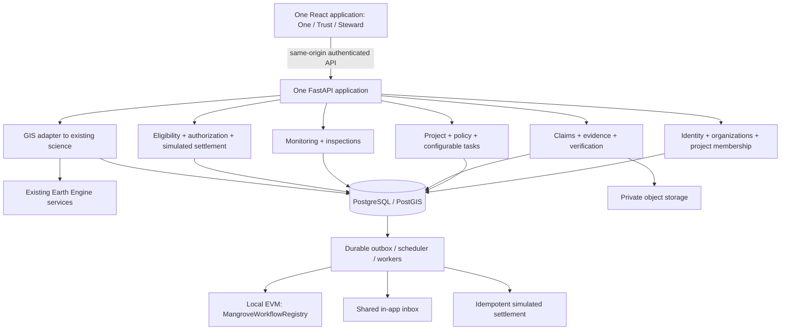

# 01 — Baseline and connected architecture

**EXISTING** is source verified at revision `17d75b5d323f71839bab5703c4690d77cdc2e1cb`. **PROPOSED** is the PB-1 execution target. The historical [audit](../01-repository-audit.md) remains the detailed component, endpoint, model, environment and dependency inventory.

## Existing behavior to preserve

| Verified finding | Execution consequence |
| --- | --- |
| React/Vite SPA: `/` and `/analysis`; Leaflet/Leaflet Draw/React Leaflet. | Preserve routes and science UI; add a shared authenticated shell and new routes. |
| FastAPI analysis, map and EE endpoints; Pydantic DTOs, no ORM or persistent business models. | Add `/api/v1` business APIs and migrations; never reinterpret AnalysisResults as a claim. |
| Demo branch without geometry; live EE custom-AOI branch with geometry; fixed Indus reference summary. | Expose source modes precisely. Reuse existing science without recalculating rewards from carbon values. |
| Global overlay vs regional GMW sources differ; sparse GEDI; 2020 mask; approximate biomass equations. | Keep source/date/uncertainty metadata; no automatic survival or proof of planting. |
| Polygon helper drops holes; current Analysis UI blocks known-zero GMW overlap. | New business AOI editor must preserve holes and allow degraded restoration sites. Do not silently reuse unsuitable validation. |
| Caches process-local; custom successes have no general expiry/size cap; exports may recompute; PDF uses temp PNG/network tiles. | Persist exact accepted analysis/export bytes and provenance through an adapter; do not call export later to reconstruct evidence. |
| EE credential auth only; no person login, database, uploads, tasks, claims, notifications, contracts or payments. | All business functionality is new. CORS is not authorization. |
| Thread-pool response timeout exists but does not stop running EE work; Content-Length-based guard; configuration-only `/ready` returns 200. | Keep science behavior; plan bounded business jobs, byte limits and separate operational checks. |
| Vercel SPA rewrites only `/` and `/analysis`; env templates ignored; README Node minimum stale; broken backend venv. | Foundation tickets repair reproducibility and hosting additions after implementation approval. |

Historical verification: 139 frontend tests passed; backend tests could not start because the venv references a missing Python and system Python lacks pytest. No new live EE or runtime assurance is implied here.

## Proposed ownership and runtime

One backend owns transactions and shared IDs. Modules call application services internally, not duplicate HTTP services. Trust is the review/evidence view of a submission; Steward is the worker/task/payment view of the **same** submission. Monitoring is the same inspection stream from every module, and notifications deep-link to the same resource.

| Module/package proposal | Authority |
| --- | --- |
| `identity` | Users, sessions, organizations, membership, project permissions; stable fictional actor-to-demo-signer binding. |
| `projects` | Project/site revisions, organization ownership, policy versions, task-type definitions and assignments. |
| `evidence` | Upload lifecycle, private immutable objects, evidence versions/sets, integrity checks and automatic-check runs. |
| `trust` | Claims/revisions, supply observations, review assignments, field decisions and reversals. |
| `monitoring` | Milestones, due scheduling, inspections, field observations and context snapshots. |
| `steward` | Worker workload, completion links, component eligibility, authorization and settlement. |
| `audit` / `notifications` | Append-only shared events, transactional outbox, chain commands/receipts, recipient inbox/read state. |
| `integrations` | Existing GIS adapter, object storage, local-EVM clients and payment simulator. |

These are future folders/services, not created implementations. Proposed runtime is static SPA with same-origin reverse proxy, FastAPI service, worker/scheduler process from the same backend package, PostgreSQL/PostGIS, private S3-compatible object storage and a local EVM. No paid hosting choice or dependency version is implicitly approved. Local EVM accounts are backend-controlled fictional role signers; no user wallet UI is required for PB-1. This makes the on-chain role boundary demonstrable while disclosing backend custody.

## Shared request transaction pattern

Authenticate → authorize scope/conflicts → validate DTO/revision/idempotency → lock aggregate and relevant inventory/obligation rows → check transition invariants → write immutable revisions/decisions plus state projection → insert AuditEvent and outbox commands in the **same** transaction → commit → return resource and pending operation links. Workers perform external work after commit. No open DB transaction waits for EE/object storage/blockchain.

Some writes are asynchronous: new evidence validation, automatic checks, GIS snapshot calculation, chain publication and settlement. Return a durable Operation, not a promise that an in-memory background callback will finish. New reads expose business, chain and settlement states separately. Screen polling ends at terminal state or unmount, with an accessible refresh button.

## Boundary rules

1. Project/site and policy revisions are immutable after publication. Assignments pin those revisions; old assignments do not inherit later rates or thresholds.
2. An exact subject revision and sealed evidence digest must appear in every approval. Field visits record method, date, measurement and inspection evidence; a green automatic check is insufficient.
3. Hashes, nursery supply, satellite context, human approval, blockchain receipt and simulated settlement each answer different questions. No universal `approved` or `paid` flag collapses them.
4. The on-chain contract can enforce configured milestone approvals, role/address separation, committed versions and one authorization per obligation. FastAPI still enforces organization/project access, units, spatial validity, evidence quality, human identity and actual fictional policy calculation.
5. Every decision/correction has one shared AuditEvent; inbox entries are projections of that event. Neither inbox delivery nor chain failure rolls back an already committed review decision.
6. All seeded fixtures say fictional; all scientific context states say live, persisted snapshot, fixture, unavailable or no-data. Demo time/date manipulation must never be silently substituted for production time.

This is an additive architecture. Existing source paths and scientific equations remain untouched until a separately authorized implementation ticket explicitly requires a compatible integration change.
