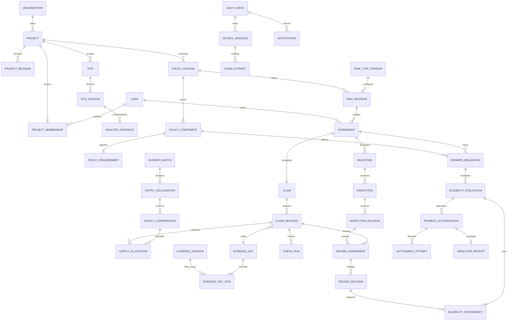

# 04 — Database model, ERD and transaction plan

**PROPOSED PostgreSQL/PostGIS schema.** These are execution specifications, not applied migrations. Existing Pydantic scientific DTOs remain unchanged and are not ORM entities.

## Conventions

Use UUID primary keys, `created_at timestamptz`, organization/project foreign keys and `demo_namespace` on every business aggregate. Mutable drafts/state projections have integer `row_version`; submitted content has immutable revision rows. All quantities are `numeric(18,4)` with explicit unit; primary plantation counts are nonnegative integers. Money is nonnegative `bigint amount_minor` and ISO-style currency code `PKR`; no float currency. Store UTC timestamps and explicit business dates.

References into project-scoped records must include project consistency: unique `(project_id,id)` keys and composite FKs where applicable. Enforce immutable submitted fields by repository rules plus restricted DB update paths/triggers tested in migration suite. `current_revision_id` is a projection; decisions always reference concrete immutable IDs.

## Logical table catalog

Required columns are named below; `?` denotes nullable. Each row also uses the conventions above where relevant.

| Tables | Fields / key relations / constraints |
| --- | --- |
| `organizations` | id, fictional name, code unique within namespace, active. |
| `users`, `organization_memberships` | User login unique, display name, password_hash, active; membership `(organization_id,user_id,role)`, active period. No real identity/bank attributes. |
| `sessions` | user_id?, anonymous/authenticated kind, token_digest unique, CSRF secret digest, expires_at, revoked_at; tokens never in logs. Anonymous bootstrap supports CSRF-safe login. |
| `project_memberships` | project_id, user_id, role, active period, granted_by; partial unique active tuple; grant/revoke AuditEvent. |
| `signer_bindings` | user_id, actor_commitment, address, chain_deployment_id; unique user/deployment, address/deployment and actor/deployment. Key secret reference stored in local configuration, not this table. No reassignment within deployment. |
| `projects`, `project_revisions` | project organization/name/code/state/current_revision_id; revision number, description, site_version_id?, policy_version_id?, prepared_by, submitted_by?, published_at?, supersedes_id?. Published fields immutable, `(project_id,revision)` unique. |
| `sites`, `site_versions` | Stable site/project; version with geometry `geometry(Polygon,4326)`, raw-GeoJSON object reference, canonical geometry digest, bbox, computed geodesic area_ha, source/label, version_no, reason; unique site/version. Geometry valid/nonempty/positive, holes preserved; no MultiPolygon in PB-1. |
| `task_type_versions` | organization_id, code (five allowlisted types), version, form_schema JSONB, unit, evidence_profile JSONB, check_profile_version, milestone/reward templates, published_at. Unique org/code/version; server checks bounded allowlisted config. |
| `policy_versions` | project_id, version, document EvidenceVersion reference?, site_version_id, task_type_version_id, due-date rules, inspection thresholds/windows/method, verification rules, policy_hash, draft/published state, publisher_id/time. Immutable after publish. |
| `policy_components`, `policy_requirements` | Component UUID/code/kind, policy_version_id, unit/rate_minor/cap_minor, amount_formula version, enabled; requirement `(component_id,milestone_code)`. Primary `final_reward` requires PLANTING/M3/M6. Exact rate/threshold approvals in decision register. |
| `tasks`, `task_revisions` | task project/site, current revision; revision task_type_version_id, policy_version_id, quantity/unit, due date, title/instructions, evidence checklist, draft/published state; do not assign against a draft. |
| `assignments` | task_revision_id, worker_id, assigned_by, state, accepted_at?, started_at?, version; stable unique active `(task_revision_id,worker_id)` and unique chain_assignment_key. Primary single worker/one cohort. |
| `nursery_batches`, `supply_declarations` | batch project/code/species; immutable declaration version, nursery operator, quantity/unit, available_date, evidence_set_id, status; unique batch/revision. |
| `supply_confirmations` | declaration_id, confirmer_id, observed_quantity, accepted_quantity, visit_date, evidence_set_id, reason, outcome, digest, reversed_at?; one current accepted confirmation per declaration; cannot exceed observation without reason/rule (primary requires accepted <= observed <= declared). |
| `supply_allocations` | confirmation_id, assignment_id, claim_revision_id?, quantity, state (reserved/consumed/released), supersedes_id?; check positive; sum bounded under lock on confirmation inventory row. |
| `claims`, `claim_revisions` | stable claim per assignment; revision_no, site_version_id, policy_version_id, work_date/start/end, claimed_quantity/unit, type-specific form JSONB, evidence_set_id, optional snapshot_id, submitted_by?, submitted_at?, check_run_id?, supersedes_id, state; one current submitted revision per assignment. |
| `evidence_uploads` | owner/project, planned type/size, random object_key, state, expiry, completion idempotency, object version?, validation result; incomplete objects garbage-collected after policy window. |
| `evidence_assets`, `evidence_versions` | stable project-scoped asset; version_no, immutable private object key+version, raw-byte SHA-256, detected MIME, size, caption, declared_capture_time?, measured GPS/accuracy/source?, uploader/time, supersedes_id?; unique asset/version. Submitted originals never overwritten. |
| `evidence_sets`, `evidence_set_items` | set project/creator, state draft/sealed, manifest_object_version, digest, sealed_at; items exact evidence_version_id/category/order. Unique set/version item; sets referenced by subjects sealed and nonempty. |
| `check_runs`, `check_findings` | exact subject revision FK, input digest, profile/version, status, start/end; findings code/severity/details/acknowledgment requirements. Unique active run for same input/profile; append reruns, retain prior findings. |
| `review_assignments`, `review_decisions` | assignment subject FK, assigned verifier/by, conflict snapshot, state; decision exact subject revision, subject/evidence/policy/check digests, outcome, accepted_quantity?, field_inspection_revision_id, notes, reviewer, decision_at, supersedes_decision_id?, effective/revoked state. Subject FKs constrain exactly one of claim/inspection; nursery confirmation uses its own table. |
| `milestones` | assignment_id, policy_requirement_code (PLANTING/M3/M6), due_date?, window dates?, state projection, active_observation_id?, active_decision_id?; unique assignment/code. Planting points to accepted claim, M3/M6 to inspection revisions. |
| `inspections`, `inspection_revisions` | milestone_id and inspector assignment, purpose (`observation` or `review_visit`), review_assignment_id?, source_observation_revision_id?, version, visit_date, method, original_cohort_count, live/dead/missing_count, sample design?, GPS?, field notes, environment_context_status, evidence_set_id, submitted_at?, submitter, status; counts sum to cohort in census, denominator unchanged. Independent review report is not promoted as the worker's observation. |
| `analysis_snapshots` | project/site_version, optional milestone, mode (`live`,`persisted`,`fixture`,`unavailable`,`no_data`), dates/convention, exact request/result JSONB, source asset IDs, units, warning/assumptions, processing fingerprint, code revision, acquisition metadata, captured_at, content digest/export EvidenceVersion refs. Snapshots immutable. |
| `reward_obligations` | assignment_id, policy_component_id, payee_id, unit/currency, state, current_eligibility_id?; unique assignment/component regardless claim revisions/retries. |
| `eligibility_evaluations`, `eligibility_dependencies` | obligation_id, exact claim and milestone decision IDs, input_digest, amount_minor, formula/rate/quantity/cap snapshot, outcome/reason list, evaluated_at, effective flag; dependency rows concrete decision FK, version/digest; one effective eligible evaluation per obligation, append reevaluations. |
| `payment_authorizations` | obligation_id, eligibility_evaluation_id, authorizer_id, amount_minor, currency, authorization_digest, human_state, chain_operation_id?, chain_authorization_key, requested/approved times, reason/cancel metadata; partial unique active authorization per obligation for requested/approved_pending_chain/authorized states; rejected/cancelled history does not occupy slot. |
| `settlement_attempts`, `simulator_receipts` | authorization_id, obligation_id, attempt_no, stable provider idempotency key=obligation key across reissued authorities, status, hold, request/result digests, error, start/end; simulator receipt unique obligation key, executing authorization_id, amount/currency, `simulated=true`. Unknown attempts reconciled before retry. |
| `disputes`, `revocations` | concrete claim/decision/authorization target, opened_by/reason, state, disposition, decided_by/time; revocation target/replacement?, event link. Historical approvals and settled receipts never deleted. |
| `audit_events` | immutable event_id, org/project, aggregate type/id/revision, actor, action, before/after states, minimal metadata, payload commitment, occurred_at, recorded_at, correlation/request ID. No signed URLs, credentials or binary evidence. |
| `outbox_messages`, `operations` | outbox event_id+consumer unique, payload schema/hash, state, attempts, next_attempt, lease owner/expiry; operation owner/project/type/state/result_ref/error/retryability. One external command may yield many attempts. |
| `chain_deployments`, `chain_commands`, `chain_attempts`, `chain_event_projections` | deployment chain ID/genesis identity/address/code hash/version; command event ID+payload+actor+dependencies; attempt nonce/tx_hash/submitted_at/receipt block/hash/status; projections unique deployment/tx/log index, canonical flag and block checkpoint. Store configured local confirmation depth. |
| `notification_intents`, `notifications`, `notification_reads` | intent event+template/recipient; unique event/recipient/template/channel; delivered inbox row with safe resource route/summary, created_at; read_at? unique user/notification. Recipient scope rechecked on read and delivery. |
| `scheduled_jobs`, `idempotency_records` | scheduler unique milestone+job_kind+due_date; leasing/retry/delivered; request key scoped to user/method/resource, payload digest, cached status/response/ref/expiry. Different payload with same key => conflict. |

There is no duplicate TrustProject/StewardProject, duplicate evidence database or notification store per module. PolicyComponents and reward obligations support completion and survival separately without inventing token balances.

## ERD (principal relationships)

Optional lifecycle cardinalities are enforced in phase-specific transitions rather than pretending every assignment already has a claim/receipt. ReviewAssignment uses nullable concrete claim_revision/inspection_revision FKs and exactly-one CHECK, not an unconstrained generic subject string. Supply references a declaration and its own confirmation/reversal record.

## Transaction/locking recipes

| Command | Atomic behavior |
| --- | --- |
| Publish project/policy | Validate required site/type/component rows and complete role roster; lock project; publish immutable revision/digest, create audit/outbox; subsequent assignments pin it. |
| Submit claim | Lock assignment and inventory confirmations in sorted ID order; check available quantity minus reserved/consumed; seal/check evidence references; activate revision/reserve stock; create check operation, audit and next jobs. |
| Field decision | Lock target revision/review assignment and obligation projections; reject stale version/conflicts/unresolved hard checks; append decision, mark effective result, consume accepted supply/reserve remainder correctly, create milestones/evaluation command and chain command/inbox intents. Partial acceptance consumes accepted quantity; release only unplanted, explicitly accounted remainder. Primary fixture accepts full quantity. |
| Eligibility/authorization | Lock obligation, dependency decisions and active authorization; compute exact current policy result, verify no holds; uniqueness prevents duplicate obligation/authority. Human approval creates chain command, not settlement. |
| Settlement enqueue | Lock authorization/obligation; recheck current confirmed chain evidence and no DB/chain hold; one stable simulator key; insert attempt/outbox atomically. |
| Outbox/scheduler claim | Select due rows with lease/`FOR UPDATE SKIP LOCKED`; commit lease before external call. Recover expired lease; never rely on process-local locks. |
| Dispute/reversal | Lock dependency graph in stable order, append dispute/revocation, immediately hold unpaid obligations/commands; enqueue chain revocation before any resumption; preserve old evidence. |

Row locks and retry handling must be intentional; PostgreSQL supports explicit row locks, but the chosen lock order and unique constraints are application design. [PostgreSQL locking](https://www.postgresql.org/docs/current/explicit-locking.html).

## Indexes, retention and migrations

Indexes: project/org scope + state/time; worker assignments + due_date; review assignee + status; milestone due date/status; obligation unique key; evidence raw hash for duplicate flags; outbox next-attempt/status/lease; notification recipient+unread+created_at; chain deployment+block/tx/log; GiST site geometry. Put JSONB indexes only on demonstrated query fields; typed values used in decisions belong in columns.

Migration order: identity/org/session → projects/site/PostGIS → task types/policy → tasks/assignments → evidence/upload → nursery/claims/checks → reviews/monitoring → obligations/eligibility/payment/simulator → outbox/notification/chain/dispute indexes. If outbox/audit tables are needed by earlier modules, create their base tables in foundation and add typed FKs later. Backups include DB, object versions/manifests and deployment registry; chain snapshot/reset requires a new deployment identity and projections reset, never silently reuse old tx hashes.

PostGIS validates 2D geometry, not rights or restoration suitability. Use geography/geodesic area, enforce finite lon/lat/topology/complexity/area caps, and preserve submitted bytes separately from normalized geometry. [PostGIS validation](https://postgis.net/docs/ST_IsValid.html).

Production retention is not inferred; synthetic fixture retention/reset is specified in document 15. Do not cascade-delete published evidence, decisions, obligations, audit or settlement records; use restricted FKs and explicit archival/tombstone procedures.
