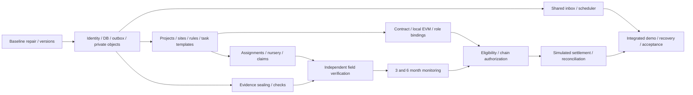

# 13 — Development dependencies and sprint backlog

**PROPOSED execution only; no ticket below has been implemented.** A sprint is a reviewable work increment, not a promised calendar duration. Assign dates/owners when deadline and team capacity are known; no additional product approval is needed merely to choose routine compatible libraries or file organization.

## Dependency graph

Outbox/inbox foundations precede business notifications. Hash/ABI/policy schemas are frozen before contract implementation. Chain UI may initially show not configured; no screen may fabricate receipts while contracts are unfinished.

## Sprint 0 — Engineering baseline and schema agreements

| Ticket | Work and dependencies | Done evidence |
| --- | --- | --- |
| B00 | Confirm remaining D01–D03 defaults; retain approved product decisions. | Decision log with selected fictional policy/evidence/local confirmation defaults. |
| B01 | Repair Python environment intentionally; choose supported Node/Python and lock compatible new dependencies. | Clean-clone setup, baseline backend/frontend tests; preserve existing files/credentials; report real failures. |
| B02 | Sanitize/track environment templates, document science timeout/temp-file/runtime discrepancies. | No secret diff; Node engine matches lock; no scientific equation/output changes. |
| B03 | Freeze shared IDs/digests, DTO/schema versions, status dimensions and contract ABI; create cross-language golden vectors. | Reviewed manifest fixtures/digests, rejection cases and dependency graph; no implementation approval assumed by this document. |

## Sprint 1 — Shared foundation

| Ticket | Work and dependencies | Done evidence |
| --- | --- | --- |
| F01 | PostgreSQL/PostGIS migration/repository/session infrastructure; B01/B03. | Migrations on empty/test DB; transaction rollback and org/project FK isolation. |
| F02 | Seeded identity/org/project memberships and session/CSRF; F01. | S01/S09, SEC tests, distinct person roles and immutable actor binding metadata. |
| F03 | Audit/outbox/Operation leasing + in-app intents/inbox; F01. | S07/S10, rollback/crash/dedupe tests; no third-party messaging. |
| F04 | Private object adapter/upload validation/sealing; F01/F02/B03. | S05, EVID tests, immutable bytes/access/integrity. |
| F05 | Shared React shell/routes/clients/error/status UI; F02/F03. | S02/S03, keyboard/mobile/role rendering; legacy routes preserved. |

## Sprint 2 — Project, rules and task configuration

| Ticket | Work and dependencies | Done evidence |
| --- | --- | --- |
| P01 | Project/site versions and complete business AOI validation; F01/F02/F05. | T01/T02/S04, holes/no-mangrove/immutability tests. |
| P02 | Five TaskTypeVersions and PolicyVersion/component/requirements editor; P01/B03. | T03/T04, mask/unit/form validation, immutable assignment policy. |
| P03 | Assignments/typed task forms and scoped worker queue; P02. | W01/W02 and task-type scenarios; no duplicate assigned quantities. |
| P04 | Existing GIS adapter/persisted context snapshot, optional science exports; P01/F04. | S06 context modes/provenance, no scientific rewrite or survival inference. |

## Sprint 3 — Plantation evidence, nursery and independent acceptance

| Ticket | Work and dependencies | Done evidence |
| --- | --- | --- |
| T01-B | Nursery declaration/independent supply confirmation/inventory locks; P03/F04. | T05/T06, concurrent reservation/release tests. |
| T02-B | Claim revisions/typed submission/sealed evidence/check profiles; T01-B/F04. | T07/T08/W03, CHECK/VERSION/SUPPLY tests. |
| T03-B | Review assignment/field visits/decisions/conflict and reassignment; T02-B. | T09/T10/W04 planting mode, exact-version and self-approval failures. |
| T04-B | Shared audit/inbox handoffs for project→worker→nursery→verifier; F03/T03-B. | N01–N09, cross-role E2E without duplicated domain records. |

Ticket suffix `-B` distinguishes backlog IDs from screen IDs. Tasks can be assigned before nursery confirmation; submissions cannot bypass confirmed-stock checks.

## Sprint 4 — Concrete local-chain integration

| Ticket | Work and dependencies | Done evidence |
| --- | --- | --- |
| C01 | Implement registry ABI/guards/events using pinned toolchain; B03/P02. | CHAIN-01–12 via direct local EVM calls, no value transfer functions. |
| C02 | Actor signer binding, role grants, canonical commands/nonces/receipt-depth reconciliation; F03/C01. | role-bound signatures, command ID dedupe, receipt/orphan/unknown recovery. |
| C03 | Connect project/policy/assignment/supply/claim/decision events; T03-B/C02. | Audit displays actual keys/digests/receipts; deliberate unauthorized local call reverts. |
| C04 | Pause/reviewer rotation/revocation/cancellation dependency recovery; C03. | Revoked approval cannot authorize, no privileged bypass, historical evidence retained. |

## Sprint 5 — Monitoring and explainable rewards

| Ticket | Work and dependencies | Done evidence |
| --- | --- | --- |
| M01 | Calendar-month due dates/scheduler/observation and field-review types; T03-B/P04/F03. | S06/W04, M3/M6 templates, N10–N13, MON tests. |
| M02 | Reward obligations/components/evaluations and holds; M01/P02. | W05/W06, exact policy masks/formula snapshots, unique obligation across revisions. |
| M03 | Human authorization → contract guards/confirmation; M02/C03. | A52/Solidity amount parity, four states, N14–N17, no simulate before chain authority. |

## Sprint 6 — Simulator, integration and presentation

| Ticket | Work and dependencies | Done evidence |
| --- | --- | --- |
| S01-B | Durable idempotent simulator and settlement/audit split; M03/C04. | W07/W08, obligation-key receipts, PAY tests; no actual financial SDK/provider. |
| S02-B | Dispute/integrity/simulator unknown/reorg recovery E2E; S01-B. | Holds before dispatch; no duplicate simulated reward on crash or revised authority. |
| S03-B | Smaller flows for collection/nursery/maintenance/monitoring using common engine; P03/T03-B/M02. | One accepted/rejected example each; no copy-pasted separate task backends. |
| S04-B | CI/setup/backup+object restore/local-deployment runbooks; all foundations. | Empty setup, nested-route refresh, scoped health, DB/object/deployment restore test. |
| S05-B | Isolated synthetic seeds and full presenter walkthrough; S01-B/S03-B/S04-B. | Document 15 scenario, repeatable reset, no secrets/real identities, all acceptance blockers resolved. |

## Pull request and completion rules

Each implementation PR identifies screen/API/test IDs and migration/ABI impacts, preserves legacy scientific contracts, reports actual tests and runtime limitations, and includes fixture-safe screenshots only after UI exists. No unchecked "implemented" labels for specification-only files. Additive migrations first; security/concurrency behavior needs integration evidence, not tests mirroring a setter.

Definition of done for a feature: permission matrix honored; DTO/transition invariants checked; exact data/evidence version persisted; audit/outbox/inbox wired; chain rules/operation states truthful; success/failure/correction UX works; acceptance tests pass. Final demo done additionally requires restart/recovery walkthrough, same shared records across modules and all monetary labels simulated.

No remote provisioning, paid accounts, public blockchain deployment or production data migration is part of PB-1 by default. These would need concrete scope authorization if requested later, not a new approval for every routine implementation ticket.
